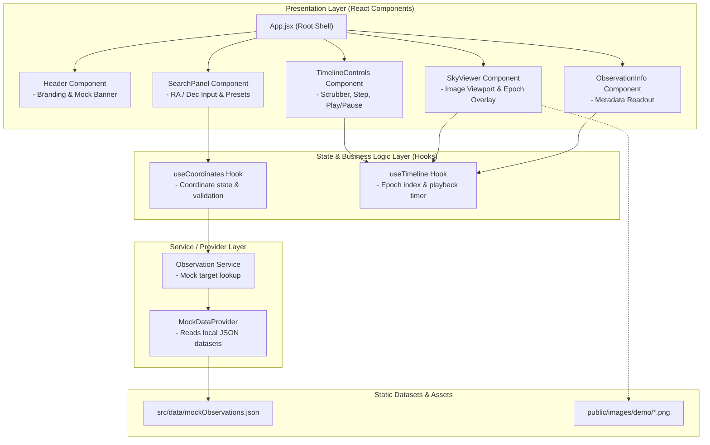

# Architecture & Data Flow — SPHEREx Explorer

**Project**: SPHEREx Explorer  
**Challenge**: 2026 NASA Space Apps Challenge  
**Status**: Architectural Specification  
**Last Updated**: 2026-11-14  

---

## 1. Architectural Overview

SPHEREx Explorer is designed as a modular, client-side Single-Page Application (SPA) utilizing React and Vite. It adheres strictly to the principles of separation of concerns:
- **Presentation Layer**: Stateless and stateful React UI components responsible purely for rendering and user input capture.
- **State Management & Custom Hooks**: Isolated reactive hooks managing coordinate state, active target resolution, epoch indexing, and timeline playback timers.
- **Service & Provider Layer**: Abstraction layer for querying mock astronomical targets and observation sequences from local static JSON datasets.
- **Static Assets & Data**: Local static JSON files and image assets served directly via Vite static hosting.

---

## 2. System Architecture Diagram

---

## 3. Data Flow

1. **Coordinate Input**:
   - The user inputs Right Ascension (RA) and Declination (Dec) in `SearchPanel` or selects a preset demo target.
   - `useCoordinates` validates the inputs against astronomical boundaries ($0 \le \text{RA} < 360$, $-90 \le \text{Dec} \le 90$).
2. **Target Resolution**:
   - The coordinates trigger a lookup in `ObservationService`.
   - `MockDataProvider` retrieves the matching target record and its associated array of chronological observations from `mockObservations.json`.
3. **Active Target & Epoch Setup**:
   - The active target is returned to application state.
   - `useTimeline` initializes the epoch sequence, defaulting to epoch index 0 (first chronological observation).
4. **Synchronized Viewport & Metadata Rendering**:
   - `SkyViewer` receives the active observation's `imageUrl` and displays the sky image.
   - `ObservationInfo` renders the observation metadata (timestamp, coordinates, simulated spectral band, epoch number).
   - `TimelineControls` displays the current position on the scrubber and updates playback states.
5. **Timeline Interaction**:
   - User actions (Next, Previous, Scrubber scrub, or Play timer tick) update the active epoch index in `useTimeline`.
   - State propagation triggers re-rendering of `SkyViewer` and `ObservationInfo` simultaneously.

---

## 4. Key Architectural Boundaries

- **UI decoupled from Data Fetching**: No UI component may directly import or parse raw JSON datasets. All access must proceed through service providers (`src/services/providers/`).
- **Timeline Logic decoupled from Presentation**: `TimelineControls` only renders UI and dispatches callbacks. Playback intervals, timers, bounding, and index stepping are encapsulated within custom hooks (`src/hooks/useTimeline.js`).
- **Zero Backend Assumption**: All data operations are synchronous or in-memory asynchronous promises simulating data queries without network calls.

---

## 5. Architectural Items Requiring Confirmation

> [!NOTE]
> The following architectural decisions require confirmation before Phase 2 implementation:

1. **State Management Scope**: Confirm whether a lightweight React Context provider (e.g., `ObservationContext`) is preferred over prop-drilling from `App.jsx` [Requires Confirmation].
2. **Image Preloading Strategy**: Confirm whether adjacent epoch images should be pre-cached into the browser cache to eliminate visual latency during auto-playback [Requires Confirmation].
