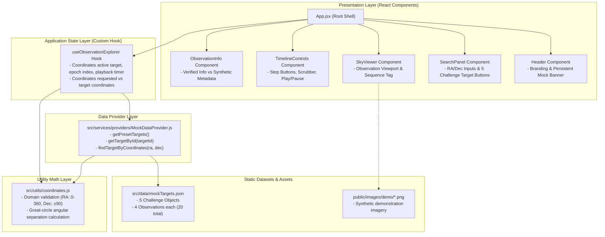
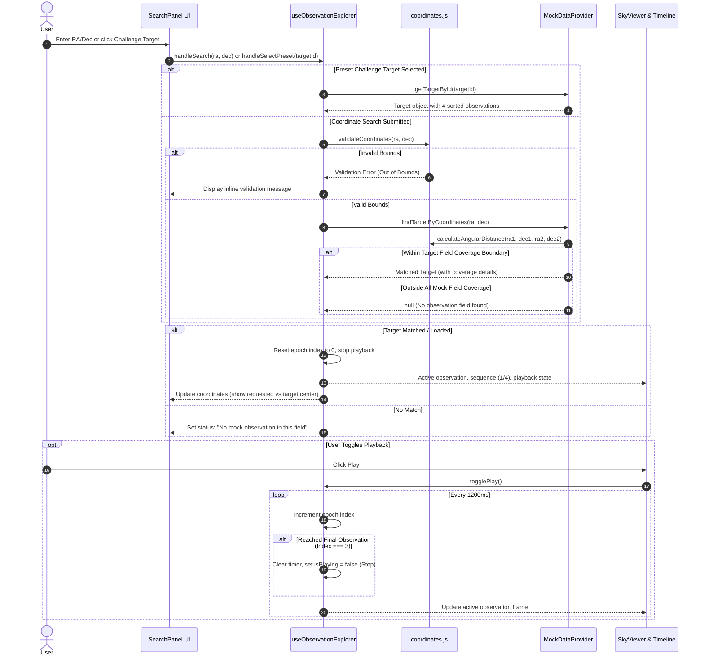

# Architecture & Data Flow — SPHEREx Explorer

**Project**: SPHEREx Explorer
**Challenge**: 2026 NASA Space Apps Challenge
**Status**: Architecture Baseline (Phase 2 Finalized)
**Last Updated**: 2026-11-14

---

## 1. Architectural Overview

SPHEREx Explorer is designed as a focused, modular client-side Single-Page Application (SPA) built on React 18 and Vite. It maintains strict decoupling between presentation components, state management, and data access.

The core architectural layers are:
1. **Presentation Layer (`src/components/`)**: Clean, independent UI components purely responsible for rendering and emitting user actions. UI components **never** access JSON datasets or coordinate math directly.
2. **Application State Layer (`src/hooks/`)**: Centralized in the `useObservationExplorer` custom hook, coordinating active target selection, observation sequence indexing, timeline playback timers, and input validation without introducing unnecessary React Context.
3. **Data Provider Layer (`src/services/providers/`)**: Consolidated in a single `MockDataProvider` module that imports local static JSON (`src/data/mockTargets.json`) and exposes clean, queryable accessor methods.
4. **Utility Layer (`src/utils/`)**: Pure, stateless mathematical and formatting functions (`src/utils/coordinates.js`), including angular distance calculations and boundary checks.
5. **Static Assets (`public/images/demo/`)**: Local static demonstration images representing synthetic observation epochs.

---

## 2. System Architecture Diagram

---

## 3. Data Flow & State Lifecycle

---

## 4. Component & Module Responsibilities

### 4.1 `src/services/providers/MockDataProvider.js`
The single authoritative data access module. Responsibilities:
- `getPresetTargets()`: Returns an array of the five NASA challenge objects (`id`, `name`, `ra`, `dec`, `constellation`, `description`, `fieldCoverageDegrees`).
- `getTargetById(targetId)`: Retrieves the target record and ensures its observations are sorted in ascending chronological order by `timestamp`.
- `findTargetByCoordinates(ra, dec)`: Iterates through mock target fields, computes great-circle celestial separation against target center coordinates, and returns the target if the separation is within that target's documented coverage boundary. Returns `null` if outside all target coverage.

### 4.2 `src/utils/coordinates.js`
Pure, stateless utility functions:
- `validateCoordinates(ra, dec)`: Checks that RA and Dec are valid numbers and satisfy $0.0 \le \text{RA} < 360.0$ and $-90.0 \le \text{Dec} \le +90.0$.
- `calculateAngularDistance(ra1, dec1, ra2, dec2)`: Computes angular separation $\Delta\theta$ using the spherical law of cosines:
  $$\Delta\theta = \arccos\left(\sin(\delta_1)\sin(\delta_2) + \cos(\delta_1)\cos(\delta_2)\cos(\alpha_1 - \alpha_2)\right)$$
- `formatCoordinates(ra, dec)`: Standardizes coordinates for human-readable display.

### 4.3 `src/hooks/useObservationExplorer.js`
The central coordinator hook. It encapsulates:
- `activeTarget`: Currently selected challenge target or `null`.
- `currentObservationIndex`: Integer pointer ($0 \le \text{index} < N$, default 0).
- `isPlaying`: Boolean state controlling the automated playback interval timer.
- `searchCoordinates`: Object tracking requested coordinates `{ ra, dec }`.
- `searchError`: Message when coordinates are invalid or outside coverage.
- **Timer Management**: Handles `setInterval` at 1200ms, automatically clearing the timer and pausing when reaching the last observation index.

### 4.4 Presentation Components (`src/components/`)
- All components receive data and action callbacks via props from `App.jsx`.
- Components maintain no independent data caching, external state subscriptions, or timer side-effects.

---

## 5. Architectural Boundaries & Guardrails

1. **Decoupled UI**: Presentation components remain agnostic of JSON file paths, providers, and mathematical formulas.
2. **Transparent Coordinate Display**: The interface must visibly distinguish user requested coordinates from target field center coordinates whenever an observation is displayed.
3. **Zero Backend / Serverless**: No backend endpoints or remote storage.
4. **No Premature Context**: For this focused single-screen application, standard React hook composition in `App.jsx` prevents unnecessary Context re-render performance costs.
