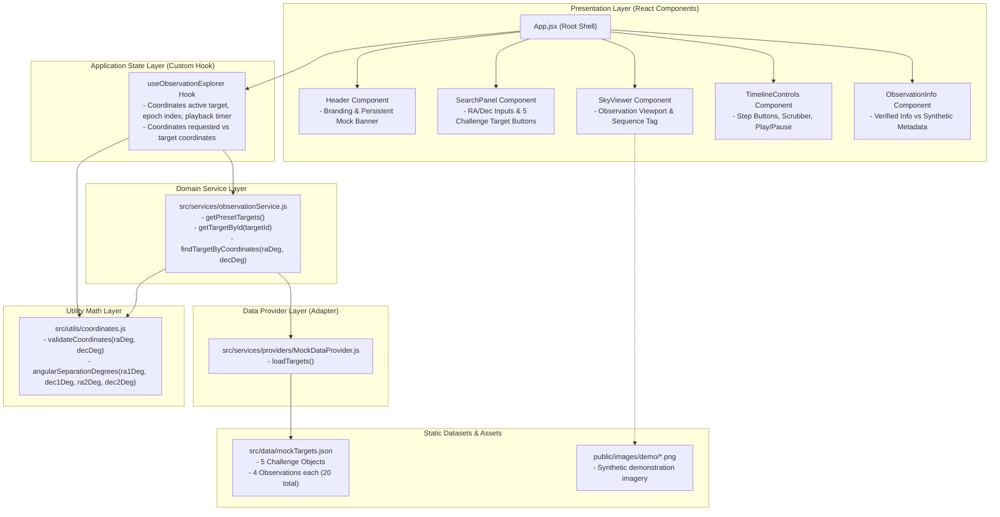
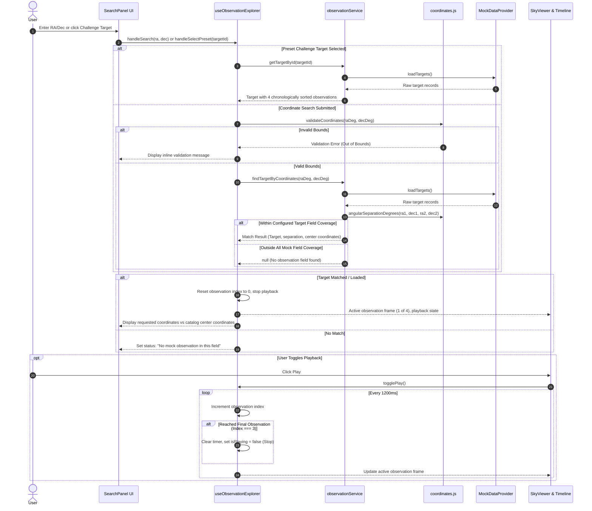

# Architecture & Data Flow — SPHEREx Explorer

**Project**: SPHEREx Explorer
**Challenge**: 2026 NASA Space Apps Challenge
**Status**: Architecture Baseline (Phase 2 Finalized & Hardened)
**Last Updated**: 2026-11-14

---

## 1. Architectural Overview

SPHEREx Explorer is designed as a modular client-side Single-Page Application (SPA) built on React 18 and Vite. It maintains strict decoupling between presentation components, state management, domain services, data adapters, and mathematical utilities.

The core architectural layers are:
1. **Presentation Layer (`src/components/`)**: Clean, independent UI components purely responsible for rendering and emitting user actions. UI components **never** access JSON datasets or coordinate math directly.
2. **Application State Layer (`src/hooks/useObservationExplorer.js`)**: Centralized custom hook coordinating active target selection, observation sequence indexing, timeline playback timers, and search status without introducing unnecessary React Context.
3. **Domain Service Layer (`src/services/observationService.js`)**: The application domain service owning target resolution, coordinate matching policies, and chronological observation sorting.
4. **Data Provider Layer (`src/services/providers/MockDataProvider.js`)**: The local data-access adapter isolating the application from physical JSON storage (`src/data/mockTargets.json`).
5. **Utility Layer (`src/utils/coordinates.js`)**: Pure, stateless mathematical functions, including numerically stable great-circle angular separation and boundary checks.
6. **Static Assets (`public/images/demo/`)**: Local static demonstration images representing synthetic observation epochs.

---

## 2. System Architecture Diagram

---

## 3. Data Flow & Sequence

---

## 4. Module Responsibilities & Contracts

### 4.1 Data Provider: `src/services/providers/MockDataProvider.js`
The physical data-access adapter.
- **Contract**: `loadTargets()`: Asynchronously or synchronously imports and returns raw target objects from `src/data/mockTargets.json`.
- **Restrictions**: Does not perform math, coordinate matching, filtering, sorting, or business rule evaluations.

### 4.2 Domain Service: `src/services/observationService.js`
The application domain logic owner.
- `getPresetTargets()`: Returns the five challenge target summaries for quick-select buttons.
- `getTargetById(targetId)`: Resolves target record and ensures observations are sorted in ascending chronological order by `timestamp`.
- `findTargetByCoordinates(raDeg, decDeg)`:
  - Iterates through available target fields.
  - Calls `angularSeparationDegrees(raDeg, decDeg, target.ra, target.dec)`.
  - Evaluates whether separation $\le \text{target.fieldCoverageDegrees}$.
  - If multiple fields match, selects the target with the minimum angular separation.
  - Returns a structured match object: `{ target, separationDegrees, requestedCoordinates: { ra: raDeg, dec: decDeg }, targetCenterCoordinates: { ra: target.ra, dec: target.dec } }`.
  - Returns `null` if no target field covers the requested coordinates.

### 4.3 Coordinate Utilities: `src/utils/coordinates.js`
Pure mathematical utility functions:
- `validateCoordinates(raDeg, decDeg)`: Ensures $0.0 \le \text{raDeg} < 360.0$ and $-90.0 \le \text{decDeg} \le +90.0$.
- `angularSeparationDegrees(ra1Deg, dec1Deg, ra2Deg, dec2Deg)`:
  Computes great-circle separation using a numerically stable spherical law of cosines formula:
  $$\Delta\theta = \arccos\left(\sin(\delta_1)\sin(\delta_2) + \cos(\delta_1)\cos(\delta_2)\cos(\alpha_1 - \alpha_2)\right)$$
  Correctly handles RA wraparound across the $0^\circ / 360^\circ$ boundary.

### 4.4 Custom Hook: `src/hooks/useObservationExplorer.js`
The central state coordinator:
- Manages `activeTarget`, `currentObservationIndex`, `isPlaying`, `searchCoordinates`, `matchDetails`, and `searchError`.
- Manages the 1200ms auto-playback interval and automatically clears it on observation 4.
- No direct JSON access or embedded mathematical formulas.

---

## 5. Architectural Guardrails

1. **Strict Service / Provider Partition**: Providers only read storage; services only execute domain rules.
2. **Coordinate Transparency**: The UI visibly displays requested coordinates alongside matched target center coordinates.
3. **Zero Backend**: All operations execute locally in the browser.
4. **No Premature Global Context**: Single-view application avoids React Context boilerplate.
