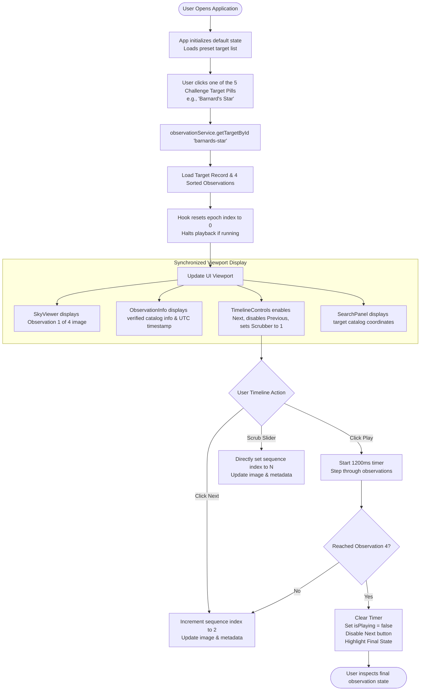
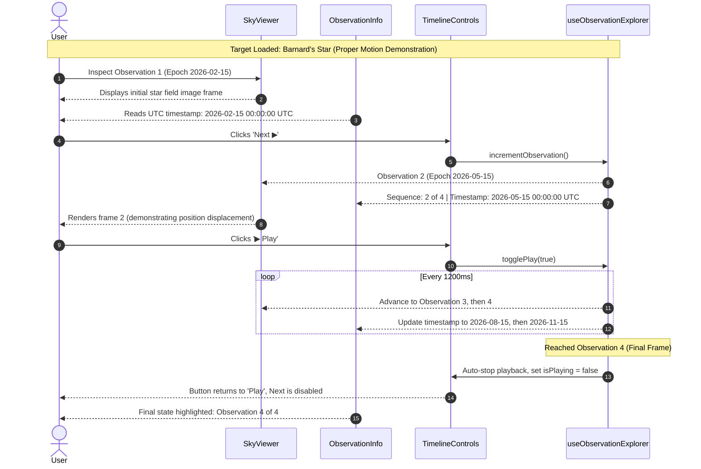

# 02 — User Flows & Interaction Journeys

**Project**: SPHEREx Explorer
**Challenge**: 2026 NASA Space Apps Challenge
**Phase**: Phase 3 — Dedicated UI/UX Design (TASK-301)
**Status**: Design Specification (Awaiting Review & Approval)
**Last Updated**: 2026-11-14

---

## 1. Flow Overview & Architectural Mapping

The user journeys in SPHEREx Explorer map directly to the domain service (`observationService.js`) and the state coordinator hook (`useObservationExplorer.js`).

All journeys respect the core architectural constraints:
- Pure client-side execution.
- Decimal degree inputs ($0.0 \le \text{RA} < 360.0$, $-90.0 \le \text{Dec} \le +90.0$).
- Spatial matching against documented per-target mock field coverage boundaries.
- Strictly ascending chronological UTC timestamps.
- Automated playback halting at the final observation (Observation 4).
- Zero scientific calculation or image analysis.

---

## 2. Primary User Journeys

### 2.1 Journey A: Explore a Preset Challenge Target

This is the primary happy path for first-time visitors and evaluators exploring the five NASA challenge objects.

#### Step-by-Step Experience Detail:
1. **Entry**: App loads with the first challenge target (Barnard's Star) preselected by default to prevent a blank, confusing empty canvas.
2. **Target Switch**: User clicks another pill (e.g., `WISE 0855`).
3. **State Mutation**: `currentObservationIndex` resets to `0` (Observation 1). Any active playback timer is cleared immediately.
4. **Visual Synchronization**:
   - `SkyViewer` renders the local synthetic image asset for Observation 1.
   - `ObservationInfo` displays verified factual information (Designation, Constellation, Catalog Coordinates, Reference Citation) along with synthetic observation parameters (Timestamp, Sequence 1 of 4, `MOCK DATA` badge).
   - `TimelineControls` shows Scrubber at tick 1, `Previous` disabled, `Next` enabled.
5. **Playback**: Clicking `Play` steps through observations 2, 3, and 4 at 1200ms intervals. Upon reaching Observation 4, the timer terminates automatically, button reverts to `Play`, and `Next` becomes disabled.

---

### 2.2 Journey B: Search by Coordinates & Field Coverage Matching

This journey handles users entering custom celestial coordinates (RA and Dec) to find corresponding demonstration sky fields.

```mermaid
flowchart TD
    StartSearch([User Navigates to Search Panel]) --> InputRA[User types RA in decimal degrees]
    InputRA --> InputDec[User types Dec in decimal degrees]
    InputDec --> ValidateInput{Valid Numbers & Domains?<br/>0 <= RA < 360<br/>-90 <= Dec <= 90}

    ValidateInput -->|No: Non-numeric / Empty| ShowTypeError[Display inline error: 'Please enter valid numerical degrees'<br/>Disable Search button]
    ValidateInput -->|No: Out of Bounds| ShowBoundError[Display inline error: 'RA must be 0-359.99°, Dec -90 to +90°'<br/>Disable Search button]

    ValidateInput -->|Yes| EnableSearch[Enable 'Search Field' Button]
    EnableSearch --> ClickSearch[User clicks 'Search Field']

    ClickSearch --> ComputeDist[observationService.findTargetByCoordinates ra, dec]
    ComputeDist --> CheckCoverage{Separation <= target.fieldCoverageDegrees?}

    CheckCoverage -->|Yes: Target Field Matched| MatchFound[Resolve closest target record]
    MatchFound --> TranspUI[Coordinate Transparency View]

    subgraph Transparency ["Coordinate Transparency Display"]
        TranspUI --> DispReq[Show User Requested: RA, Dec]
        TranspUI --> DispCenter[Show Target Catalog Center: RA, Dec]
        TranspUI --> DispSep[Show Angular Separation & Coverage Status]
    end

    TranspUI --> LoadObservations[Load 4 demonstration observations for matched field]
    LoadObservations --> SuccessEnd([User explores observation sequence])

    CheckCoverage -->|No: Outside All Coverage| NoMatch[Return null / No Match Found]
    NoMatch --> ShowFallback[Render Friendly Empty State:<br/>'No mock observations available in this field'<br/>Display quick-select challenge target chips]
    ShowFallback --> FallbackAction{User Chooses Target}
    FallbackAction -->|Click Target Chip| SelectTarget[Load Selected Challenge Target]
```

#### Step-by-Step Experience Detail:
1. **Input Interaction**: User enters `269.45` into RA and `4.69` into Dec.
2. **Instant Validation**: Inputs validate on blur/change. If out of bounds (e.g., `Dec: 105.0`), an amber inline warning appears: *"Declination must be between -90.0° and +90.0°"*, and the submit button is disabled.
3. **Execution**: User clicks "Search Field".
4. **Spatial Resolution**: `observationService` computes great-circle angular separation between `(269.45, 4.69)` and the catalog centers of all five challenge targets.
5. **Coverage Evaluation**:
   - The separation to Barnard's Star center `(269.452, 4.693)` is calculated as $\approx 0.0037^\circ$ ($\approx 13$ arcseconds).
   - This falls well within Barnard's Star configured mock demonstration field coverage.
6. **Coordinate Transparency Rendering**:
   - The UI displays the demonstration frames.
   - Crucially, the metadata panel prominently displays:
     - `Requested: RA 269.450°, Dec +4.690°`
     - `Matched Field Center: RA 269.452°, Dec +4.693°`
     - `Offset: 0.004° from field center`
7. **No-Match Recovery**: If user enters `RA 100.0, Dec 20.0` (outside all 5 target fields), the viewer gracefully transitions into an empty field state: *"No mock demonstration observations are configured in this sky field. Select one of the five NASA challenge targets below to explore active fields."*

---

### 2.3 Journey C: Inspect Multi-Epoch Temporal Changes

This journey describes the analytical exploration of an observation sequence over time.

---

## 3. Edge Cases & Error Recovery Paths

| Edge Case | User Condition | System Response | Recovery Path |
| :--- | :--- | :--- | :--- |
| **Out-of-Bounds Coordinate** | User types RA: `410.0` or Dec: `-95.0`. | Real-time inline validation banner; "Search Field" button disabled. | User corrects numerical value within valid astronomical bounds. |
| **Non-Numeric / Text Input** | User pastes `18h 30m 00s` or alpha characters. | Field highlights amber; inline message: *"Please enter decimal degrees (e.g. 180.25)"*. | User re-enters value in decimal degrees. |
| **Uncovered Sky Coordinates** | User enters coordinates in unobserved sky region. | Returns clean fallback view; sky viewer displays placeholder field grid; no crash. | One-click chips allow instant jump to any of the 5 challenge targets. |
| **Image Asset Missing / 404** | Image file missing from `public/images/demo/`. | Viewport catches image `onError` and displays an accessible framing box: *"Demonstration graphic unavailable for this epoch"*. | User can step forward or select another target without app disruption. |
| **Scrubbing During Playback** | User drags scrubber slider while auto-play is running. | Scrubber interaction immediately clears the auto-play timer and pauses playback. | Observation updates smoothly to the scrubbed position; user can click Play to resume. |
