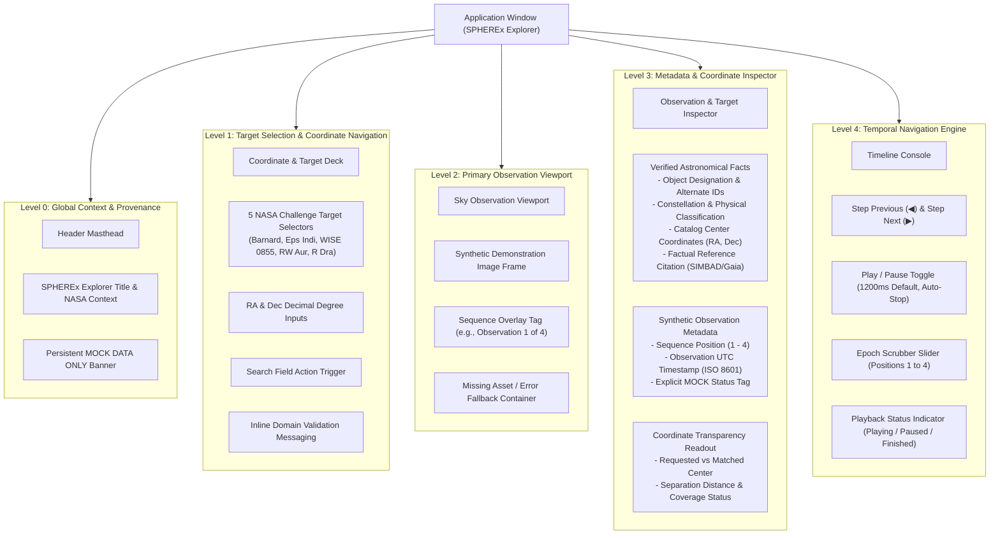

# 03 — Information Architecture & Content Hierarchy

**Project**: SPHEREx Explorer
**Challenge**: 2026 NASA Space Apps Challenge
**Phase**: Phase 3 — Dedicated UI/UX Design (TASK-301)
**Status**: Architecture Specification (Awaiting Review & Approval)
**Last Updated**: 2026-11-14

---

## 1. Information Architecture Model

The Information Architecture (IA) of SPHEREx Explorer is designed as a **focused, single-screen scientific workstation** organized to prioritize visual observation analysis while providing rapid access to coordinates, metadata, and timeline controls.



---

## 2. Content & Attribute Taxonomy

To enforce the non-negotiable scientific data integrity rules established in [AGENTS.md](file:///C:/Users/Star/Desktop/nasa/AGENTS.md) and [DATA_SCHEMA.md](file:///C:/Users/Star/Desktop/nasa/docs/DATA_SCHEMA.md), content attributes are strictly partitioned into **Factual Astronomical Catalog Content** versus **Synthetic Demonstration Content**.

### 2.1 Layer 1: Factual Astronomical Catalog Attributes
*These attributes represent peer-reviewed catalog data from SIMBAD, Gaia DR3, and NASA/IPAC WISE. They are never labeled as synthetic.*

| Attribute Name | Semantic Label | Example Content | Source Provenance |
| :--- | :--- | :--- | :--- |
| `name` | Primary Object Name | `Barnard's Star` | Astronomical Catalogs |
| `alternateDesignations` | Alternate Designations | `GJ 699, HIP 87937, BD+04 3561a` | SIMBAD |
| `constellation` | Constellation | `Ophiuchus` | IAU Constellations |
| `objectType` | Object Classification | `Red Dwarf (M4.0V) / High Proper Motion` | Astrophysical Catalogs |
| `ra` | Catalog Center RA | `269.452°` | Gaia DR3 (ICRS J2016.0) |
| `dec` | Catalog Center Dec | `+4.693°` | Gaia DR3 (ICRS J2016.0) |
| `coordinateSource` | Catalog Citation | `SIMBAD / Gaia DR3 (ICRS, Epoch J2016.0)` | Peer-reviewed Database |
| `description` | Astrophysical Summary | Brief educational context explaining why the object is scientifically noteworthy. | Editorial Science |

### 2.2 Layer 2: Synthetic Demonstration Content
*These attributes represent demonstration assets and simulation parameters. Every element carries explicit mock identification.*

| Attribute Name | Semantic Label | Example Content | Data Nature |
| :--- | :--- | :--- | :--- |
| `imageUrl` | Demonstration Sky Frame | `/images/demo/barnards_star_ep01.png` | **Synthetic Image Asset** |
| `sequence` | Observation Frame Number | `Observation 1 of 4` | **Demonstration Sequence** |
| `timestamp` | Observation Timestamp | `2026-02-15T00:00:00Z` | **Synthetic UTC Timestamp** |
| `fieldCoverageDegrees` | Mock Coverage Boundary | Defined per-target in mock data | **Demonstration Framing Parameter** |
| `isMock` | Data Integrity Tag | `⚠️ Simulated Demo Frame (MOCK)` | **Mandatory Integrity Flag** |

### 2.3 Layer 3: Coordinate Transparency Attributes
*Computed dynamically by `observationService.js` to ensure total user clarity.*

| Attribute Name | Semantic Label | Example Value | Description |
| :--- | :--- | :--- | :--- |
| `requestedCoordinates` | Requested Search Coordinates | `RA: 269.450°, Dec: +4.690°` | The exact numerical values typed by the user. |
| `targetCenterCoordinates` | Field Center Coordinates | `RA: 269.452°, Dec: +4.693°` | The catalog position where the image frame is centered. |
| `separationDegrees` | Angular Offset | `0.004° (13.3 arcsec)` | Great-circle distance between requested position and center. |
| `matchStatus` | Field Coverage Status | `Within Target Field Coverage` | Clear confirmation that user point falls inside demo field. |

---

## 3. UI State Architecture

The application transitions through six discrete operational states:

```text
+-------------------+       User selects preset target
| 1. Initial State  | -------------------------------------> +------------------------+
| (Default Target:  |                                        | 2. Matched Target View |
|  Barnard's Star)  | <------------------------------------- | (Full Active Console)  |
+-------------------+       User clicks preset pill          +------------------------+
          |                                                               |
          | User types RA/Dec                                             | User edits coordinates
          v                                                               v
+-------------------+       Input out of bounds / non-numeric        +------------------------+
| 3. Input Active   | ---------------------------------------------> | 5. Validation Error    |
| (Validating live) | <--------------------------------------------- | (Inline alert banner,  |
+-------------------+       User corrects numbers                     |  search disabled)     |
          |                                                          +------------------------+
          | User clicks 'Search Field'
          v
+-------------------+       Separation > fieldCoverageDegrees
| 4. Search Query   | ---------------------------------------------> +------------------------+
| (Computing dist)  |                                                | 6. Outside Coverage    |
+-------------------+                                                | (Friendly empty field, |
          |                                                          |  challenge jump links) |
          | Separation <= fieldCoverageDegrees                       +------------------------+
          +--------------------------------------------------------> +------------------------+
                                                                     | 2. Matched Target View |
                                                                     +------------------------+
```

### State Definitions:
1. **Initial / Pre-Loaded State**: App initializes with the first challenge target (Barnard's Star) preselected. This prevents presenting an intimidating, blank empty canvas to first-time users.
2. **Matched Target State**: Active observation frame displayed, metadata panel populated, timeline enabled and responsive.
3. **Input Active State**: User is modifying numerical inputs; validation evaluates live.
4. **Validation Error State**: Input is outside valid boundaries ($0 \le \text{RA} < 360$, $-90 \le \text{Dec} \le 90$) or contains illegal characters. Inline amber alert appears; search button is disabled.
5. **Outside Coverage State**: Valid coordinates were searched, but they do not fall within any of the five challenge target fields. The viewer displays an unoccupied field placeholder with clear guidance and quick-select buttons to return to active fields.
6. **Image Error State**: The image fails to load; the viewer renders a high-contrast fallback container with clear diagnostic messaging without breaking the timeline or metadata panel.
