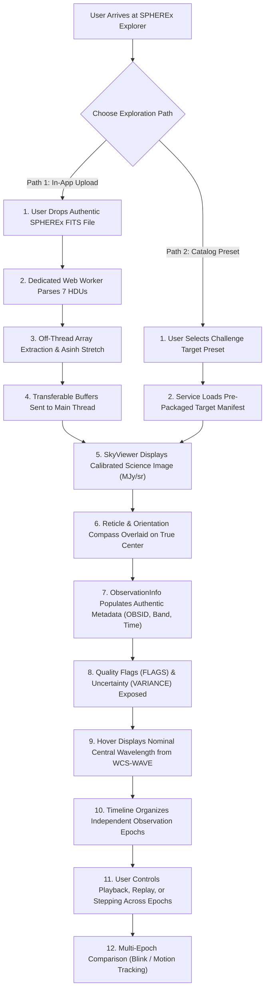

# SPHEREx Data Ingestion Architecture & Processing Analysis

**Project**: SPHEREx Explorer  
**Event**: 2026 NASA Space Apps Challenge  
**Document Version**: 1.1.0  
**Last Verified**: 2026-11-15  
**Audience**: Software Architects, Frontend Engineers, Astronomy Data Engineers  

---

## 1. Executive Summary & Core Product Requirement

A core product requirement of **SPHEREx Explorer** is that the web application must provide a first-class, in-browser capability for users to:
1. **Upload authentic SPHEREx FITS files** directly through the web interface (via file picker or drag-and-drop).
2. **Programmatically parse and inspect** the Multi-Extension FITS (MEF) structure (Primary HDU + 6 extensions).
3. **Display calibrated scientific image data** (`IMAGE` in $\text{MJy/sr}$) within the existing `SkyViewer`.
4. **Inspect available scientific metadata**, quality flags (`FLAGS`), and uncertainty data (`VARIANCE`) in `ObservationInfo`.
5. **Extract and visualize nominal spectral information** from `WCS-WAVE` (distinguishing pixel-level nominal wavelength from multi-pointing source spectrophotometry).
6. **Support multiple observation epochs** independently from the 102 spectral channels within the `TimelineControls`.

This document evaluates the architectural approaches to deliver this mandatory capability, defines the technical role of Web Workers, establishes the reference validation role of Python/Astropy, details the 12-step user journey, and sets strict scientific processing boundaries.

---

## 2. Evaluation of Architectural Approaches

```mermaid
flowchart TD
    subgraph OptionA ["Option A: In-Browser FITS Ingestion (Core Mandatory Requirement)"]
        A1["User Local FITS File (.fits / .fits.gz)"] --> A2["HTML5 File API / Drag & Drop"]
        A2 --> A3["Dedicated Web Worker (src/workers/fitsWorker.js)
        - Parses 7 HDUs (Primary + 6 Extensions)
        - Unpacks Big-Endian Float32 Arrays
        - Computes Asinh / ZScale Visual Stretch"]
        A3 -->|Transferable ArrayBuffers| A4["Main UI Thread
        - SkyViewer: Calibrated Image Canvas
        - ObservationInfo: Metadata, FLAGS, VARIANCE
        - Spectral Inspector: WCS-WAVE Lookup
        - Timeline: Multi-Epoch Navigation"]
    end
    
    subgraph OptionB ["Option B: Direct In-Browser Archive API (Exploratory / Deferred)"]
        B1["User Enters RA / Dec"] --> B2["Browser fetch() to IRSA SIA2 / Cutout"]
        B2 --> B3["CORS Barrier: Unverified Browser Origin Support"]
        B3 --> B4["Requires Proxy or Gateway"]
    end
    
    subgraph OptionC ["Option C: Python Reference Pipeline & Asset Generator (Validation)"]
        C1["Archive Query (Astroquery / TAP)"] --> C2["Python Pipeline (Astropy, NumPy, SciPy)"]
        C2 --> C3["Curated Challenge Target Cutouts & Fallbacks"]
        C2 --> C4["Ground-Truth Numerical Verification for Web Worker"]
    end
```

### Option A — First-Class In-Browser FITS Upload & Processing (Core Requirement)

Users select or drag-and-drop authentic SPHEREx Level 2 MEF files (`.fits` or `.fits.gz`) directly into the dashboard.

- **FITS Parsing Off the Main Thread**: Parsing is handled by a dedicated Web Worker (`src/workers/fitsWorker.js`). Offloading binary header parsing, big-endian byte-swapping, and float32 decompression prevents freezing the user interface during file ingestion.
- **Multi-Extension HDU Traversal**: The Web Worker reads all seven HDUs:
  1. `PRIMARY` (HDU 0): Parses key keywords (`OBSID`, `INSTRUME`, `DATE-OBS`, `EXPTIME`, `RA_PNT`, `DEC_PNT`).
  2. `IMAGE` (HDU 1): Extracts calibrated float32 surface brightness arrays ($2040 \times 2040$).
  3. `FLAGS` (HDU 2): Decodes integer data quality bitmasks.
  4. `VARIANCE` (HDU 3): Extracts per-pixel statistical variance arrays.
  5. `ZODI` (HDU 4): Extracts zodiacal foreground arrays.
  6. `EPSF` (HDU 5): Reads the empirical PSF cube.
  7. `WCS-WAVE` (HDU 6): Parses the binary lookup table mapping detector coordinates to nominal central wavelengths and bandwidths.
- **Memory & Performance Optimization**:
  - Raw uncompressed MEFs contain $2040 \times 2040 \times 4\ \text{bytes} \times 4\ \text{image arrays} \approx 66.5\ \text{MB}$ of float32 data.
  - To prevent JavaScript garbage collection pressure and memory bloat, the Web Worker uses **Transferable Objects** (`postMessage(..., [buffer])`) to transfer typed arrays directly to the main thread with zero memory copying.
  - For visual rendering, the worker computes a downscaled or stretch-normalized 8-bit visual preview buffer for Canvas rendering, while retaining access to the full float32 array for cursor hover inspection.
- **Advantages**: Completely fulfills the mandatory product requirement; provides 100% user autonomy to inspect private, newly released, or custom SPHEREx files; requires zero backend server infrastructure; operates fully offline.
- **Engineering Challenge**: Requires implementing or integrating a robust, standards-compliant FITS parser within the Web Worker that correctly decodes FITS binary tables (`WCS-WAVE`) and image arrays.

### Option B — Direct In-Browser Archive API Integration (Deferred)

The web application queries IRSA directly via SIA2/TAP and retrieves observation cutouts via HTTP `fetch()`.

- **CORS Status**: **Unverified.** Standard browser security blocks cross-origin requests unless the target server explicitly returns `Access-Control-Allow-Origin: *`. IRSA's production TAP and IBE cutout endpoints have not been verified for unrestricted client-side browser origins.
- **Bandwidth**: Full Level 2 MEFs (~70MB–100MB) are too heavy for live browser streaming over consumer connections.
- **Decision**: Deferred until CORS compatibility is empirically tested or a dedicated gateway is approved.

### Option C — Python Scientific Pipeline (Validation & Curated Baseline Generator)

An offline Python pipeline using `astropy.io.fits`, `astropy.wcs.WCS`, `astroquery`, and `numpy`.

- **Reference Implementation Role**: Acts as the authoritative scientific benchmark to validate the client-side Web Worker parser's numerical accuracy (verifying pixel values, WCS transformations, and header extraction).
- **Curated Asset Generator**: Pre-packages verified demonstration cutouts and metadata manifests for the 5 mandatory challenge targets, ensuring the application loads instantly upon launch even before the user uploads their own files.
- **Crucial Boundary**: Python is an engineering and validation tool; it **must not** replace the in-app FITS upload capability.

---

## 3. Architecture Comparison Matrix

| Evaluation Dimension | Option A: In-Browser FITS Ingestion (Worker) | Option B: Direct IRSA Archive API | Option C: Python Reference Pipeline |
| :--- | :--- | :--- | :--- |
| **Product Requirement Fit** | **Mandatory Core Requirement** | Exploratory / Future | Reference & Validation Tool |
| **Scientific Correctness** | High (Verified against Astropy reference) | High (Direct server cutouts) | **Highest** (Astropy gold standard) |
| **Development Complexity** | High (MEF parsing + Web Worker) | High (CORS proxy + async error handling) | Low (Standard Python scripts) |
| **Main-Thread Performance** | **High** (Async Web Worker, zero UI lag) | Moderate (Network download latency) | **Instant** (Pre-computed static baseline) |
| **Browser Memory Footprint** | Managed via Transferable Buffers | Moderate (Streamed cutouts) | Minimal (<1MB static manifest) |
| **Offline Capability** | **100% Offline** (User local files) | No (Requires active internet) | **100% Offline** |
| **Backend Requirement** | **Zero Backend** (Pure client-side SPA) | Requires external proxy server | Zero Backend (Offline scripts) |
| **User Autonomy** | **Complete** (Inspects any SPHEREx FITS) | Limited to archived public data | Limited to preprocessed targets |

---

## 4. Recommended Architecture: Hybrid In-App Upload with Reference Validation

To satisfy the mandatory product requirement while ensuring absolute scientific integrity and rock-solid demo performance:

1. **In-Browser FITS Upload as Primary User Workflow**:
   - Provide a prominent, accessible **FITS Upload Dropzone** in the SPHEREx Explorer dashboard.
   - Users can drag-and-drop or select authentic SPHEREx Level 2 MEF files (`.fits`, `.fits.gz`).
   - The dedicated Web Worker (`src/workers/fitsWorker.js`) parses the file, extracts metadata and calibrated arrays, and streams them to the dashboard.
2. **Pre-Packaged Baseline for Immediate Demonstration**:
   - The curated 5 challenge objects (Barnard's Star, Epsilon Indi B, WISE 0855, RW Aurigae, R Draconis) remain available out-of-the-box as pre-packaged demonstration datasets, allowing instant exploration upon initial page load.
3. **Astropy Scientific Validation Reference**:
   - Use Python/Astropy in TASK-602 as an automated validation oracle to test the Web Worker's output against standard Astropy parsing, ensuring identical numerical results down to machine precision.

---

## 5. Intended Dashboard Workflow (Real-Data User Journey)

The application unifies curated exploration and custom FITS upload into a coherent 12-step user journey:

---

## 6. Scientific Processing Boundaries & Data Layer Limitations

### 6.1 The Seven HDUs: Roles & Limitations
A SPHEREx Level 2 Spectral Image MEF file comprises **seven HDUs in total** (1 Primary HDU + 6 Extensions):

| Product Layer | HDU Index | Role in SPHEREx Explorer | Limitations & Integrity Constraints |
| :--- | :--- | :--- | :--- |
| **`PRIMARY`** | HDU 0 | Extracts observation metadata (`OBSID`, `DATE-OBS`, `EXPTIME`, `RA_PNT`, `DEC_PNT`, band identifier). | Header only (`NAXIS = 0`); contains no spatial array data. |
| **`IMAGE`** | HDU 1 | Calibrated science array displayed in `SkyViewer`. | Calibrated in surface brightness (**$\text{MJy/sr}$**), not point-source flux. Contains zodiacal background. |
| **`FLAGS`** | HDU 2 | Inspectable data quality bitmask. Used to highlight saturated or corrupted pixels. | Qualitative flags; never treat as flux. Corrupted pixels must be visually identified. |
| **`VARIANCE`** | HDU 3 | Displays per-pixel uncertainty ($\sigma = \sqrt{\text{VARIANCE}}$) in `ObservationInfo`. | Statistical variance only; does not include large-scale systematic zero-point errors. |
| **`ZODI`** | HDU 4 | Model zodiacal light emission along the line of sight. | Large-scale smooth model; does not account for point-source blending. |
| **`EPSF`** | HDU 5 | Oversampled empirical Point Spread Function grid. | Required for PSF-fitting photometry; requires spatial interpolation across the detector array. |
| **`WCS-WAVE`**| HDU 6 | Quick-look nominal wavelength ($\lambda$) and bandwidth ($\Delta\lambda$) lookup on hover. | **Approximate lookup for visualization only.** Must not be used for precision spectrophotometry. |

### 6.2 Science-Grade Calibration Arrays: `CWAVE` and `CBAND`
- `CWAVE` (median transmission central wavelength array in microns) and `CBAND` (bandwidth array in microns) are distributed as external science-grade calibration arrays ($2040 \times 2040$).
- When operating in standalone in-browser upload mode, the viewer uses the embedded `WCS-WAVE` table for responsive nominal wavelength readouts, explicitly labeled as *quick-look nominal filter wavelength*.

### 6.3 Observation Epochs vs. 102 Spectral Channels
- **102 Spectral Channels**: Near-infrared wavelength bandpasses from 0.75 µm to 5.00 µm across 6 detector bands.
- **Observation Epochs**: Discrete temporal survey passes.
- **Coverage Reality**: Targets do **not** automatically possess 4 observation epochs. Celestial targets near the ecliptic equator receive ~4 survey visits over 2 years, whereas targets near the ecliptic poles receive hundreds of visits. The timeline must display the actual observation timestamps present in the uploaded files or queried archive records.

### 6.4 Single-Pixel Lookup vs. Source Spectrophotometry
- Hovering over a pixel in `SkyViewer` displays the nominal central wavelength and bandpass passing through the Linear Variable Filter at that coordinate.
- **A single pixel or single image does NOT represent an astronomical spectrum.**
- Generating a scientifically valid 102-point spectrum requires multi-pointing aperture/PSF photometry across multiple dithered exposures and detector bands with local background subtraction. The UI must explicitly reinforce this distinction.
