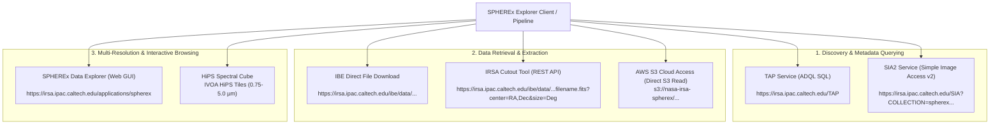

# NASA/IPAC IRSA SPHEREx Archive Access Guide

**Project**: SPHEREx Explorer  
**Event**: 2026 NASA Space Apps Challenge  
**Document Version**: 1.0.0  
**Last Verified**: 2026-11-15  
**Audience**: Data Engineers, Software Architects, Astronomy Pipeline Developers  

---

## 1. Overview of IRSA SPHEREx Data Access Services

The NASA/IPAC Infrared Science Archive (IRSA) at Caltech serves SPHEREx mission data through multiple protocols adhering to International Virtual Observatory Alliance (IVOA) standards and modern cloud architectures:



---

## 2. Service Matrix: Purpose & Appropriate Use

To ensure software components use the correct service for each operation, adhere strictly to this service allocation matrix:

| Task / Operation | Recommended Service | Protocol / Endpoint | Format Returned |
| :--- | :--- | :--- | :--- |
| **Discovering images covering a sky coordinate** | **SIA2 or TAP** | `https://irsa.ipac.caltech.edu/SIA` or `https://irsa.ipac.caltech.edu/TAP` | VOTable, JSON, CSV |
| **Checking sky-footprint polygon overlap** | **TAP (ADQL)** | `https://irsa.ipac.caltech.edu/TAP/sync` | JSON / VOTable |
| **Downloading full MEF spectral images** | **IBE or AWS S3** | `https://irsa.ipac.caltech.edu/ibe/data/...` | Multi-Extension FITS |
| **Retrieving targeted sub-image cutouts** | **IRSA Cutout Tool** | `.../filename.fits?center=RA,Dec&size=Deg` | Multi-Extension FITS Cutout |
| **Accessing all-sky 3D spectral cubes** | **HiPS / S3** | `HiPS Cube Service` / `s3://...` | FITS / PNG HiPS Tiles |
| **Interactive visual inspection** | **SPHEREx Data Explorer** | `https://irsa.ipac.caltech.edu/applications/spherex` | Interactive Web UI |

---

## 3. Image Discovery Protocols

### 3.1 Simple Image Access Protocol Version 2 (SIA2)
- **Endpoint**: `https://irsa.ipac.caltech.edu/SIA`
- **Method**: HTTP `GET` or `POST`
- **Standard**: IVOA SIA v2.0
- **Primary Parameters**:
  - `COLLECTION`: Target collection identifier (e.g. `spherex_dr1_spectral_images` or `spherex_qr3_spectral_images`).
  - `POS`: Positional constraint using `CIRCLE <ra> <dec> <radius>` (degrees) or `POINT <ra> <dec>`.
  - `BAND`: Spectral energy constraint (e.g. `0.75 5.0` in micrometers).
  - `TIME`: Temporal range in MJD or ISO-8601.
  - `RESPONSEFORMAT`: `application/x-votable+xml` or `application/json`.
- **Example SIA2 Query**:
  ```http
  GET /SIA?COLLECTION=spherex_dr1_spectral_images&POS=CIRCLE 330.84 -56.79 0.05&RESPONSEFORMAT=application/json HTTP/1.1
  Host: irsa.ipac.caltech.edu
  ```

### 3.2 Table Access Protocol (TAP) & ADQL Queries
The IRSA TAP service allows direct SQL/ADQL querying of the SPHEREx database metadata catalog.
- **Synchronous Endpoint**: `https://irsa.ipac.caltech.edu/TAP/sync`
- **Asynchronous Endpoint**: `https://irsa.ipac.caltech.edu/TAP/async`
- **Core Database Tables**:
  - `spherex.artifact`: Contains metadata for every data product file (filenames, URLs, file sizes, processing versions).
  - `spherex.plane`: Contains observation footprints, pointing vectors, exposure times, observation epochs, and spatial geometry.
- **Example ADQL Spatial Overlap Query (Epsilon Indi B)**:
  ```sql
  SELECT 
      p.plane_id,
      p.obs_id,
      p.band,
      p.date_obs,
      p.time_obs,
      p.exptime,
      a.uri,
      a.filename
  FROM 
      spherex.plane AS p
  JOIN 
      spherex.artifact AS a ON p.artifact_id = a.artifact_id
  WHERE 
      1 = CONTAINS(POINT('ICRS', 330.8400, -56.7900), p.spatial_footprint)
      AND p.collection = 'spherex_dr1'
  ORDER BY 
      p.date_obs ASC
  ```

---

## 4. File Retrieval and Cutout Services

### 4.1 Image-Based Extraction (IBE) Direct File Access
Full Multi-Extension FITS files are addressed via structured IBE URLs:
- **Base URL Template**:
  ```
  https://irsa.ipac.caltech.edu/ibe/data/spherex/{release}/level2/{band}/{year}/{month}/{day}/{filename}.fits
  ```
- **Example Structure**:
  ```
  https://irsa.ipac.caltech.edu/ibe/data/spherex/dr1/level2/band1/2026/05/15/spherex_l2_band1_obs124987.fits
  ```

### 4.2 IRSA SPHEREx Cutout Tool (REST API)
Because full Level 2 MEF files are large ($2,040 \times 2,040$ pixels across the Primary HDU and 6 extensions, totaling 7 HDUs and ~100MB uncompressed per exposure), downloading full files for small target queries is bandwidth-prohibitive.

The IRSA Cutout Tool allows extracting spatial sub-arrays while preserving all seven HDUs and updating the WCS headers:
- **REST URL Parameter Convention**:
  Append `?center=RA,DEC&size=DEGREES` or `?center=RA,DEC&size=ARCMINUTES` to the IBE file URL.
- **Example REST Cutout Query (WISE 0855, 3 arcminute cutout)**:
  ```bash
  curl -o wise0855_cutout.fits \
    "https://irsa.ipac.caltech.edu/ibe/data/spherex/dr1/level2/band3/2026/06/01/spherex_l2_band3_obs39841.fits?center=133.7951,-7.2451&size=0.05"
  ```
- **Cutout Preservation Guarantee**:
  - Extracts sub-arrays for `IMAGE`, `FLAGS`, `VARIANCE`, and `ZODI`.
  - Re-calculates `CRPIX1` and `CRPIX2` in all headers to accurately reference the cutout center.
  - Retains `PRIMARY`, `EPSF`, and `WCS-WAVE` extensions without corruption.

### 4.3 AWS S3 Direct Cloud Access (AWS Open Data)
- **Bucket**: `s3://nasa-irsa-spherex/` (us-west-2 region)
- **Access Policy**: Requester Pays or AWS Open Data Sponsorship.
- **Use Case**: Cloud-native batch processing and High-Performance Computing (HPC) workflows using `fsspec` or `boto3`.

---

## 5. SPHEREx Archive Collections: Deep vs. Wide & Variable Sky Coverage

SPHEREx executes two distinct survey modes, resulting in variable coverage depending on celestial position:

```
+-------------------------------------------------------------------------+
| Feature             | Wide All-Sky Survey       | Deep Field Surveys    |
+---------------------+---------------------------+-----------------------+
| Sky Coverage        | Full Sky (4π steradians)  | ~200 deg² (Ecliptic Poles)|
| Observation Cadence | 1 visit every ~6 months   | Multi-day repeated visits|
| Number of Passes    | ~4 passes over 2 years    | Hundreds of overlapping passes|
| Sensitivity Depth   | Survey Baseline           | ~2 magnitudes deeper  |
| Primary Collections | `spherex_dr1_wide`        | `spherex_dr1_deep`    |
| Primary Science     | Galaxy Redshift, All-Sky  | Cosmic Infrared Background, 3D Ices|
+---------------------+---------------------------+-----------------------+
```

> [!NOTE]
> **Observation Epochs Are Not Fixed at Four**:
> Celestial targets near the ecliptic equator receive ~4 observation epochs over the 2-year survey, whereas targets near the ecliptic poles receive dozens to hundreds of visits. Applications must determine actual available epochs by querying archive metadata (`spherex.plane`), never assuming a uniform 4-epoch cadence.

---

## 6. Archive Query Constraints & Technical Limitations

### 6.1 Cross-Origin Resource Sharing (CORS) Limitation
> [!WARNING]
> ### CRITICAL ARCHITECTURAL CONSTRAINT:
> - **Direct browser `fetch()` requests from client-side JavaScript (`http://localhost` or web domains) to IRSA endpoints (`https://irsa.ipac.caltech.edu/TAP` or `/ibe/data/...`) are subject to browser CORS policies. Whether IRSA endpoints return `Access-Control-Allow-Origin: *` is unverified from a browser origin and must not be assumed without empirical testing.**
> - **Architectural Mandate**: For production resilience, client-side web apps should not depend on direct live un-proxied remote archive downloads. In contrast, **in-browser local FITS file upload** relies on the HTML5 File API and is completely immune to CORS restrictions.

### 6.2 Data Transfer Volumes vs. Local File Upload
- A single full Level 2 MEF file is **~70MB–100MB**.
- Streaming full MEFs across the internet for live interactive display is network-heavy.
- **Local In-App Upload Advantage**: When a user uploads a local FITS file directly through the browser, **zero network transfer occurs**. The file is read directly from local disk into browser memory via the File API and processed in a Web Worker, ensuring high throughput and offline capability.
- When remote retrieval is required, applications must use **spatial cutouts** (~500KB per cutout) rather than full detector arrays.

### 6.3 Release Versioning & Provenance
- Release identifiers (`DR1`, `QR2`, `QR3`) correspond to specific SSDC pipeline versions.
- Every archive query must capture and persist:
  - `collection_id`: The archive collection queried.
  - `pipeline_version`: Version of the calibration pipeline recorded in the FITS header (`CAL_VER` or `PIPE_VER`).
  - `access_url`: Complete URL used to retrieve the asset.
  - `retrieval_timestamp`: UTC timestamp when the query was executed.
