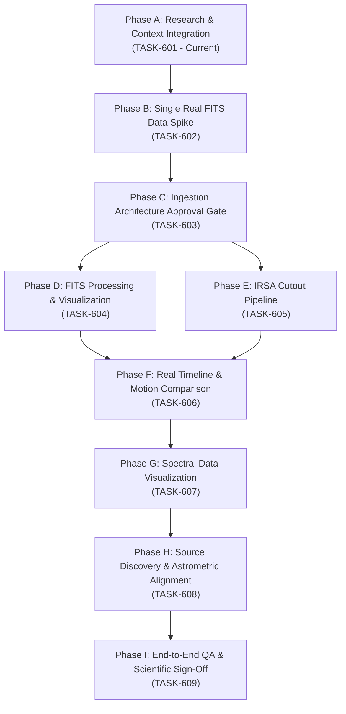

# Real Data Implementation Roadmap — SPHEREx Explorer

**Project**: SPHEREx Explorer  
**Event**: 2026 NASA Space Apps Challenge  
**Document Version**: 1.0.0  
**Last Verified**: 2026-11-15  
**Audience**: Technical Leads, AI Coding Agents, Architecture Reviewers  

---

## 1. Roadmap Architecture & Execution Philosophy

This roadmap defines the structured, phase-gated trajectory for transitioning SPHEREx Explorer from its current verified mock-data baseline into a fully authentic scientific web application.



### Key Execution Rules:
1. **Single-Target Priority**: Prioritize completing one real SPHEREx observation end-to-end (e.g. for Barnard's Star) before attempting multi-target scaling.
2. **Phase-Gated Approval**: No code modifying the application architecture or introducing new dependencies may be executed without explicit human approval at each phase gate.
3. **Preservation**: The working React application and its 28 automated tests must remain operational and passing at every step.

---

## 2. Phase-by-Phase Task Breakdown

### Phase A — Research & Scientific Context Integration (Completed)
- **Task ID**: `TASK-601` / `TASK-601.1`
- **Objective**: Establish permanent scientific documentation, source registries, MEF FITS specifications, archive access protocols, and align ADR-013 with mandatory in-browser FITS upload requirements.
- **Prerequisites**: Completed Phase 5 frontend baseline.
- **Files Involved**: `docs/research/*`, `docs/*`.
- **Deliverables**:
  - `docs/research/SOURCE_REGISTRY.md`
  - `docs/research/SPHEREX_FITS_GUIDE.md`
  - `docs/research/IRSA_ARCHIVE_ACCESS.md`
  - `docs/research/DATA_INGESTION_ARCHITECTURE.md`
  - `docs/research/WISEVIEW_INTERACTION_ANALYSIS.md`
  - `docs/research/REAL_DATA_IMPLEMENTATION_ROADMAP.md`
  - Revised ADR-013 and ADR-014 in `docs/DECISIONS.md`.
- **Acceptance Criteria**: All research documents authored and aligned; zero modification to React components; `npm run build` and `node --test` pass.
- **Automated Tests**: Current 28 tests in `node --test`.
- **Manual Tests**: Document cross-reference audit.
- **Risks**: None (Documentation and architecture planning only).
- **Commit Gate**: Human review and approval of TASK-601.1 report and revised ADR-013.

---

### Phase B — In-Browser Web Worker FITS Upload & Parsing Technical Spike
- **Task ID**: `TASK-602`
- **Objective**: Build an isolated technical proof-of-concept evaluating browser-side file selection, off-thread FITS/MEF parsing in a Web Worker, scientific image preview rendering, metadata inspection, and nominal wavelength extraction on one authentic SPHEREx Level 2 MEF file. Validate the browser results against an Astropy reference script.
- **Prerequisites**: Human approval of `TASK-601.1` and revised `ADR-013`.
- **Files Involved**: `scratch/spike/` (isolated prototype harness), `scripts/validate_fits_reference.py`, sample authentic SPHEREx MEF file.
- **Deliverables**:
  - Isolated Web Worker FITS parser prototype (`fitsWorker.js`) parsing all seven HDUs:
    - HDU 0: `PRIMARY` header metadata (`OBSID`, `DATE-OBS`, `EXPTIME`, `INSTRUME`).
    - HDU 1: `IMAGE` float32 surface brightness array ($2040 \times 2040$, $\text{MJy/sr}$).
    - HDU 2: `FLAGS` data quality bitmask array.
    - HDU 3: `VARIANCE` statistical uncertainty array ($(\text{MJy/sr})^2$).
    - HDU 4: `ZODI` zodiacal foreground model array.
    - HDU 5: `EPSF` empirical Point Spread Function grid cube.
    - HDU 6: `WCS-WAVE` binary table lookup mapping pixel coordinates to nominal $\lambda$ and $\Delta\lambda$.
  - Scientific Canvas image preview rendering with Asinh/ZScale contrast stretch.
  - Browser memory consumption profiling and parse execution time benchmarks.
  - Python Astropy reference script (`scripts/validate_fits_reference.py`) providing authoritative numerical benchmarks for pixel values, WCS transformations, and header tables.
- **Acceptance Criteria**:
  - Browser reads and parses authentic SPHEREx MEF file without blocking the main UI thread.
  - All seven HDUs traversed and decoded accurately.
  - Image preview renders scientific flux with non-destructive stretch.
  - Parsed values match Astropy reference outputs within floating-point tolerance ($1\text{e}-6$).
  - Memory consumption during parse is profiled and remains stable (<250MB peak heap) via Transferable Objects.
  - Dashboard production source files remain untouched during the spike.
- **Automated Tests**: Node/Python test script comparing parsed outputs between the Web Worker and Astropy.
- **Manual Tests**: Browser file picker upload test in isolated sandbox.
- **Risks**: High memory consumption when parsing uncompressed $2040 \times 2040$ float32 arrays (mitigated by zero-copy transferable buffers and typed array reuse).
- **Commit Gate**: Technical spike evaluation report with performance and memory benchmarks.

---

### Phase C — Ingestion Architecture Approval Gate
- **Task ID**: `TASK-603`
- **Objective**: Formalize the completed spike findings, review browser performance metrics, and approve production integration of the Web Worker FITS parser into the SPHEREx Explorer dashboard.
- **Prerequisites**: Successful Phase B spike findings.
- **Files Involved**: `docs/DECISIONS.md` (ADR-013 status update to Accepted), `docs/ARCHITECTURE.md`.
- **Deliverables**: Formal sign-off on the Web Worker integration architecture.
- **Acceptance Criteria**: Performance and memory bounds proven in Phase B; clear consensus on Web Worker contracts; zero unapproved runtime dependencies.
- **Automated Tests**: `node --test` regression suite.
- **Manual Tests**: Governance audit.
- **Risks**: None.
- **Commit Gate**: Human approval to proceed with Phase D dashboard integration.

---

### Phase D — Web Worker Dashboard Integration & Scientific Image Rendering
- **Task ID**: `TASK-604`
- **Objective**: Integrate the proven Web Worker FITS parser into the production React application, adding a first-class file upload dropzone and connecting parsed `IMAGE` arrays to `SkyViewer`.
- **Prerequisites**: Phase C approval.
- **Files Involved**: `src/workers/fitsWorker.js`, `src/components/SkyViewer/`, `src/hooks/useObservationExplorer.js`.
- **Deliverables**:
  - In-app file upload trigger and drag-and-drop zone in `SearchPanel` or `SkyViewer`.
  - Production Web Worker integrated into Vite build pipeline.
  - Dynamic scientific image rendering in `SkyViewer` Canvas with Asinh/ZScale stretch controls.
- **Acceptance Criteria**: Dropping a valid SPHEREx MEF file immediately parses and renders the calibrated image in `SkyViewer`; UI remains smooth; fallback vector placeholder displays on invalid files.
- **Automated Tests**: Worker communication contract tests in `node --test`.
- **Manual Tests**: In-app drag-and-drop file upload testing across viewports.
- **Risks**: Build bundling quirks with Web Workers in Vite (standardized using `new Worker(new URL(..., import.meta.url), { type: 'module' })`).
- **Commit Gate**: Verification that uploaded files display genuine calibrated flux in $\text{MJy/sr}$.

---

### Phase E — Multi-HDU Scientific Inspector Integration
- **Task ID**: `TASK-605`
- **Objective**: Connect parsed `FLAGS`, `VARIANCE`, `ZODI`, and `EPSF` data to `ObservationInfo`, allowing interactive inspection of authentic data quality and uncertainty arrays.
- **Prerequisites**: Phase D image integration.
- **Files Involved**: `src/components/ObservationInfo/`, `src/components/SkyViewer/`.
- **Deliverables**:
  - `ObservationInfo` displays authentic FITS header metadata (`OBSID`, `DATE-OBS`, `EXPTIME`, `INSTRUME`).
  - Interactive data quality overlay highlighting pixels with non-zero flags (saturation, cosmic rays).
  - Quantitative uncertainty display reporting surface brightness uncertainty $\sigma = \sqrt{\text{VARIANCE}}$.
- **Acceptance Criteria**: Inspector updates dynamically upon FITS upload; zero fabricated telemetry displayed.
- **Automated Tests**: Metadata extraction contract tests.
- **Manual Tests**: Verifying flags and variance readouts against known FITS header keywords.
- **Risks**: Cluttering the inspector UI with excessive technical parameters (mitigated by clean collapsible sections).
- **Commit Gate**: Scientific integrity review of metadata display.

---

### Phase F — Nominal Spectral Wavelength Readout & Multi-Epoch Timeline
- **Task ID**: `TASK-606`
- **Objective**: Implement interactive pixel-level nominal wavelength readouts from `WCS-WAVE` and support uploading multiple observation files as independent chronological epochs.
- **Prerequisites**: Phase E metadata integration.
- **Files Involved**: `src/components/SkyViewer/`, `src/components/TimelineControls/`, `src/hooks/useObservationExplorer.js`.
- **Deliverables**:
  - Cursor-hover spectral readout displaying nominal central wavelength $\lambda$ and bandwidth $\Delta\lambda$ in microns from `WCS-WAVE`.
  - Multi-file upload support: uploading multiple observation files automatically populates `TimelineControls` with independent observation epochs.
  - Clear UI labeling explicitly distinguishing single-pixel nominal filter wavelengths from complete multi-pointing source spectrophotometry.
- **Acceptance Criteria**: Hovering over image pixels displays valid wavelengths within detector band limits (0.75–5.00 µm); timeline navigates uploaded observation epochs; zero confusion between spectral channels and time epochs.
- **Automated Tests**: WCS-WAVE interpolation tests.
- **Manual Tests**: Multi-epoch file upload and timeline scrubbing.
- **Risks**: User confusion regarding single-pixel nominal wavelength vs. source spectrum.
- **Commit Gate**: Scientific accuracy sign-off.

---

### Phase G — Pre-Packaged Baseline & Astrometric Alignment
- **Task ID**: `TASK-607`
- **Objective**: Package authentic curated SPHEREx cutouts for the 5 challenge objects as pre-packaged baseline datasets, ensuring the app loads instantly on launch, and overlay Gaia DR3 proper motion vectors.
- **Prerequisites**: Phase F timeline integration.
- **Files Involved**: `src/data/spherexTargets.json`, `public/fits/spherex/`, `src/utils/coordinates.js`.
- **Deliverables**:
  - Verified static cutouts for challenge targets packaged in `public/fits/spherex/`.
  - Updated manifest `spherexTargets.json` linking curated targets directly to authentic MEF cutouts.
  - Gaia DR3 proper motion vector overlay in `SkyViewer`.
- **Acceptance Criteria**: Dashboard opens with verified challenge data on first launch; users can still upload custom files at any time.
- **Automated Tests**: Manifest contract tests in `node --test`.
- **Manual Tests**: Switching between curated targets and user-uploaded files.
- **Risks**: None.
- **Commit Gate**: Target integrity review.

---

### Phase H — End-to-End QA & Space Apps Submission Sign-Off
- **Task ID**: `TASK-608`
- **Objective**: Final quality assurance, performance profiling, accessibility audit (WCAG AA), and end-to-end user acceptance review before submission.
- **Prerequisites**: Phases A through G complete.
- **Files Involved**: Entire codebase, documentation suite.
- **Deliverables**:
  - Final Comprehensive Acceptance Report.
  - Production build verification (`npm run build`).
  - Full automated test suite passing (>35 tests).
  - Clean working tree ready for submission tagging.
- **Acceptance Criteria**: 100% compliance with `AGENTS.md` and `ACCEPTANCE_CRITERIA.md`; zero console errors or warnings; clean static production bundle.
- **Automated Tests**: Full test suite execution.
- **Manual Tests**: End-to-end user walkthrough of both curated exploration and custom FITS upload flows.
- **Risks**: None.
- **Commit Gate**: Final human approval.
- **Files Involved**: `scripts/pipeline/normalize_image.py`, `scripts/pipeline/extract_metadata.py`.
- **Deliverables**:
  - Astronomical normalization utility supporting Asinh, ZScale, and Square-Root stretching.
  - WebP and PNG graphic exporter generating display assets with embedded physical scale metadata.
  - Raw FITS cutout storage directory (`public/fits/`) for download transparency.
- **Acceptance Criteria**: Rendered graphics exhibit no pixel clipping or saturation blow-out; original min/max flux values stored in manifest.
- **Automated Tests**: Image pixel distribution tests verifying monotonic stretch mapping.
- **Manual Tests**: Visual comparison of output image against DS9/Aladin rendering.
- **Risks**: Loss of dynamic range if linear stretching is applied naively.
- **Commit Gate**: Verification that images accurately represent near-infrared sky brightness.

---

### Phase E — IRSA Discovery and Cutout Integration
- **Task ID**: `TASK-605`
- **Objective**: Implement automated TAP/ADQL and Cutout Tool querying for all five mandatory NASA Space Apps challenge objects.
- **Prerequisites**: Phase D image pipeline.
- **Files Involved**: `scripts/pipeline/fetch_irsa_cutouts.py`, `src/data/spherexTargets.json`.
- **Deliverables**:
  - Automated script generating multi-epoch cutouts (4 epochs $\times$ 5 targets) via the official IRSA Cutout REST endpoint.
  - Updated production manifest `spherexTargets.json` populated with authentic `OBSID`, `DATE-OBS`, `MJD-OBS`, and image paths.
- **Acceptance Criteria**: All 20 observation cutouts successfully fetched and verified; observation timestamps reflect genuine satellite telemetry.
- **Automated Tests**: Dataset schema contract tests in `test/integrationContracts.test.js`.
- **Manual Tests**: Coordinate alignment verification against SIMBAD catalog centers.
- **Risks**: One or more challenge objects falling outside early data release sky coverage (requires documented fallback to simulated QR frames).
- **Commit Gate**: Data integrity sign-off on `spherexTargets.json`.

---

### Phase F — Real Timeline & Multi-Epoch Motion Comparison
- **Task ID**: `TASK-606`
- **Objective**: Connect the authentic multi-epoch image sequences to the React frontend timeline, enabling genuine time-series navigation, adjustable playback cadence, and an epoch difference mode.
- **Prerequisites**: Phase E dataset integration.
- **Files Involved**: `src/hooks/useObservationExplorer.js`, `src/components/SkyViewer/`, `src/components/TimelineControls/`.
- **Deliverables**:
  - Timeline scrubbing across real observation timestamps (e.g. 2026-02-15 to 2026-11-20).
  - Variable playback cadence selector (600ms, 1200ms, 2000ms).
  - Epoch Difference mode ($I_{\text{epoch}_i} - I_{\text{epoch}_1}$) highlighting proper motion (Barnard's Star) and variability (RW Aurigae).
- **Acceptance Criteria**: Seamless playback with zero UI stutters; difference view correctly reveals motion dipoles; auto-stop and replay preserved.
- **Automated Tests**: Timeline state transition and interval timing tests.
- **Manual Tests**: Cross-browser testing of playback and difference toggling.
- **Risks**: Registration misalignment causing difference artifacts (mitigated by WCS plate alignment).
- **Commit Gate**: Responsive UI and accessibility audit.

---

### Phase G — Spectral Data Visualization
- **Task ID**: `TASK-607`
- **Objective**: Implement interactive spectral data display exposing the 102 nominal spectral channels and pixel-level wavelength mapping from `WCS-WAVE`/`CWAVE`.
- **Prerequisites**: Phase F timeline integration.
- **Files Involved**: `src/components/ObservationInfo/`, `src/components/SkyViewer/`.
- **Deliverables**:
  - Cursor-hover spectral readout displaying nominal central wavelength $\lambda$ and bandwidth $\Delta\lambda$ in microns.
  - 102-channel spectral bandpass indicator showing which detector band (Bands 1–6) captured the active frame.
  - Clear UI labeling distinguishing single-pixel nominal wavelengths from complete source spectrophotometry.
- **Acceptance Criteria**: Wavelength values match documented band limits (0.75–5.00 µm); zero confusion between channels and epochs.
- **Automated Tests**: Spectral WCS calculation tests verifying correct wavelength interpolation.
- **Manual Tests**: Verifying wavelength values against `spherex_spectral_calibrations.html`.
- **Risks**: Users misinterpreting a single-epoch pixel wavelength as a complete stellar spectrum.
- **Commit Gate**: Scientific accuracy review of spectral readouts.

---

### Phase H — Source Discovery & Astrometric Alignment
- **Task ID**: `TASK-608`
- **Objective**: Integrate Gaia DR3 astrometric overlay vectors and proper motion tracking to illustrate celestial motion across epochs.
- **Prerequisites**: Phase G spectral display.
- **Files Involved**: `src/components/SkyViewer/SkyViewer.jsx`, `src/utils/coordinates.js`.
- **Deliverables**:
  - Visual proper motion vector overlay showing predicted stellar displacement based on Gaia DR3 $\mu_\alpha^*, \mu_\delta$.
  - Astrometric reticle alignment locking catalog centers to sub-pixel accuracy across epochs.
- **Acceptance Criteria**: Barnard's Star motion vector aligns precisely with the observed displacement across epochs.
- **Automated Tests**: Proper motion epoch transformation math tests in `node --test`.
- **Manual Tests**: Astrometric alignment verification on desktop and mobile viewports.
- **Risks**: Coordinate epoch mismatches (J2000.0 vs J2016.0).
- **Commit Gate**: Astrometric accuracy audit.

---

### Phase I — End-to-End QA & Scientific Integrity Sign-Off
- **Task ID**: `TASK-609`
- **Objective**: Final quality assurance, performance auditing, accessibility compliance review, and scientific provenance validation before project submission.
- **Prerequisites**: Phases A through H complete.
- **Files Involved**: Entire codebase, documentation suite.
- **Deliverables**:
  - Final Comprehensive Acceptance Report.
  - Production build verification (`npm run build`).
  - Full test suite execution (>40 automated tests).
  - Clean Git working tree ready for submission tagging.
- **Acceptance Criteria**: 100% compliance with `AGENTS.md` and `ACCEPTANCE_CRITERIA.md`; zero console warnings or errors; clean static build.
- **Automated Tests**: Complete test runner execution.
- **Manual Tests**: Full user flow walkthrough across all 5 challenge objects.
- **Risks**: None.
- **Commit Gate**: Final human sign-off.

---

## 3. Critical Path & Parallelization Analysis

```
[Critical Path]:
Phase A (Docs) ──> Phase B (Single Spike) ──> Phase C (Decision Gate) ──> Phase D (Image Pipeline) ──> Phase E (IRSA Cutouts) ──> Phase F (Timeline) ──> Phase G (Spectra) ──> Phase I (Sign-Off)

[Parallel Track]:
- Phase E (IRSA Cutouts) and Phase D (Image Processing) can develop their core script modules in parallel once Phase C is approved.
- Phase H (Gaia DR3 Astrometric Overlay) can be drafted in parallel with Phase G (Spectral UI).
```

### Recommendation for Immediate Next Step:
Upon human review and approval of this task (`TASK-601`), the immediate next action is **`TASK-602: Single Real FITS Data Spike`** to download and inspect one authentic observation file for Barnard's Star using an isolated offline Python script.
