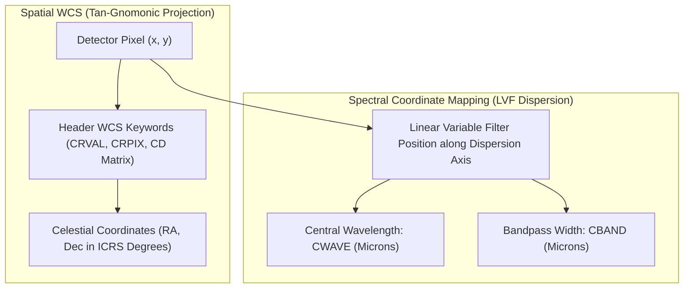

# SPHEREx Multi-Extension FITS (MEF) Technical Guide

**Project**: SPHEREx Explorer  
**Event**: 2026 NASA Space Apps Challenge  
**Document Version**: 1.0.0  
**Last Verified**: 2026-11-15  
**Audience**: Scientific Software Architects, Astronomy Engineers, Frontend Developers  

---

## 1. Executive Summary & Core Scientific Principles

The NASA **SPHEREx** (Spectro-Photometer for the History of the Universe, Epoch of Reionization, and Ices Explorer) mission maps the entire sky in near-infrared light from **0.75 µm to 5.00 µm** across **102 nominal spectral channels**.

SPHEREx Level 2 Spectral Image data products are distributed by the NASA/IPAC Infrared Science Archive (IRSA) as **Multi-Extension FITS (MEF)** files. Unlike simple single-image FITS files, each SPHEREx spectral image contains multiple Header Data Units (HDUs) that bundle calibrated science flux, data quality flags, uncertainty variance, background zodiacal light models, empirical Point Spread Functions, and spectral World Coordinate System (WCS) lookup tables into a unified container.

> [!CAUTION]
> ### FUNDAMENTAL SCIENTIFIC DISTINCTION:
> **The 102 spectral channels must NEVER be confused with 102 observation epochs!**
> - **Spatial Coordinates ($\alpha, \delta$)**: The physical pointing direction of the telescope on the celestial sphere (ICRS Right Ascension and Declination).
> - **Spectral Wavelength Coordinates ($\lambda, \Delta\lambda$)**: The near-infrared wavelength and bandpass determined by the Linear Variable Filter (LVF) position at each detector pixel. The 102 channels represent **color/wavelength bands**, not timestamps.
> - **Observation Time ($t$)**: The actual mission timestamp (e.g. UTC epoch) at which a physical exposure occurred. While SPHEREx executes an all-sky survey pass approximately once every 6 months, the actual number of observation epochs for any given target depends on its celestial coordinates (specifically ecliptic latitude). Targets near the ecliptic equator receive ~4 visits during the 2-year survey baseline, whereas targets near the North and South Ecliptic Poles (deep survey fields) receive hundreds of overlapping visits. The exact number of available epochs must be determined by querying archive metadata (`spherex.plane`), never assumed a priori.

---

## 2. Multi-Extension FITS (MEF) HDU Structure

A standard SPHEREx Level 2 Spectral Image MEF file comprises **seven HDUs in total: the Primary HDU (HDU 0) plus six extensions (HDU 1 through HDU 6: five 2D/3D image extensions and one binary table extension)**:

```
+-------------------------------------------------------------------------+
| HDU Index | Extension Name | Type         | Dimensions   | Physical Units|
|-----------|----------------|--------------|--------------|---------------|
| HDU 0     | PRIMARY        | Primary HDU  | 0 (No data)  | N/A           |
| HDU 1     | IMAGE          | Image HDU    | 2040 x 2040  | MJy / sr      |
| HDU 2     | FLAGS          | Image HDU    | 2040 x 2040  | Bitmask (int) |
| HDU 3     | VARIANCE       | Image HDU    | 2040 x 2040  | (MJy / sr)^2  |
| HDU 4     | ZODI           | Image HDU    | 2040 x 2040  | MJy / sr      |
| HDU 5     | EPSF           | Image HDU    | 21x21 (cube) | Dimensionless |
| HDU 6     | WCS-WAVE       | Binary Table | 3 cols, 1 row| µm / Table    |
+-------------------------------------------------------------------------+
```

### HDU 0: `PRIMARY`
- **Content**: The primary header contains global mission metadata, telescope pointing, spacecraft telemetry, exposure timing, pipeline software version, and observation identifiers.
- **Data Array**: None (`NAXIS = 0`). All science data resides in subsequent extensions.
- **Key Header Keywords**:
  - `TELESCOP = 'SPHEREx'`
  - `INSTRUME`: Active detector band (`BAND1` through `BAND6`).
  - `OBSID`: Unique mission observation identifier.
  - `DATE-OBS`: UTC observation start timestamp (ISO 8601).
  - `DATE-END`: UTC observation end timestamp.
  - `EXPTIME`: Total integration exposure time in seconds.
  - `RA_PNT`, `DEC_PNT`: Nominal optical boresight pointing coordinates (degrees).
  - `PA_PNT`: Position angle of the focal plane (degrees East of North).

### HDU 1: `IMAGE` (Calibrated Science Array)
- **Content**: Calibrated surface brightness near-infrared flux array.
- **Dimensions**: $2,040 \times 2,040$ pixels (representing the active photosensitive area of the $2048 \times 2048$ Teledyne H2RG detector array, excluding reference pixels).
- **Physical Units**: **$\text{MJy/sr}$ (Megajanskys per steradian)**.
- **Physical Meaning**: SPHEREx measures surface brightness. To convert surface brightness in $\text{MJy/sr}$ to point-source flux density in Janskys ($\text{Jy}$) or microjanskys ($\mu\text{Jy}$), the pixel solid angle $\Omega_{\text{pix}}$ (steradians) must be integrated:
  $$F_\nu [\text{Jy}] = I_\nu [\text{MJy/sr}] \times 10^6 \times \Omega_{\text{pix}} [\text{sr}]$$
  where for SPHEREx's nominal $6.2'' \times 6.2''$ pixel scale:
  $$\Omega_{\text{pix}} \approx \left(\frac{6.2 \times \pi}{180 \times 3600}\right)^2 \approx 9.04 \times 10^{-10} \text{ sr}$$

### HDU 2: `FLAGS` (Data Quality Bitmask)
- **Content**: Integer bitmask array ($2,040 \times 2,040$) flagging bad pixels, instrumental artifacts, and transient astrophysical events.
- **Bit Allocation (Standard Pipeline)**:
  - `Bit 0 (Value 1)`: Non-functional or dead pixel.
  - `Bit 1 (Value 2)`: Hot or excessive dark current pixel.
  - `Bit 2 (Value 4)`: Saturated pixel during integration.
  - `Bit 3 (Value 8)`: Cosmic ray hit detected.
  - `Bit 4 (Value 16)`: Cosmic ray halo / snowball energetic secondary charge spread.
  - `Bit 5 (Value 32)`: Straylight or bright earth/moon limb occultation.
  - `Bit 6 (Value 64)`: Edge pixel with degraded calibration or high vignetting.
- **Processing Rule**: Applications and display pipelines must inspect `FLAGS`. Pixels with non-zero critical flags should be masked or rendered with visual indicators rather than displayed as genuine astronomical flux.

### HDU 3: `VARIANCE` (Uncertainty Estimates)
- **Content**: Per-pixel statistical variance estimates ($2,040 \times 2,040$).
- **Physical Units**: **$(\text{MJy/sr})^2$**.
- **Standard Deviation**: The $1\sigma$ uncertainty on pixel surface brightness is:
  $$\sigma_i = \sqrt{\text{VARIANCE}_i} \quad [\text{MJy/sr}]$$
- **Signal-to-Noise Ratio (SNR)**:
  $$\text{SNR}_i = \frac{\text{IMAGE}_i}{\sqrt{\text{VARIANCE}_i}}$$

### HDU 4: `ZODI` (Zodiacal Light Background Foreground)
- **Content**: Model-estimated foreground emission from interplanetary dust (zodiacal light) within the Solar System along the line of sight ($2,040 \times 2,040$).
- **Physical Units**: **$\text{MJy/sr}$**.
- **Scientific Significance**: Zodiacal light is the dominant diffuse foreground in the near-infrared. For extragalactic or deep-field background studies, the net astronomical flux is estimated as:
  $$I_{\text{net}} = \text{IMAGE} - \text{ZODI}$$

### HDU 5: `EPSF` (Empirical Point Spread Function Grid)
- **Content**: An oversampled image cube containing empirical Point Spread Functions measured across the detector surface.
- **Structure**: Dimensionless, normalized PSF cutouts sampled on a spatial grid across the detector:
  - Bands 1, 2, 4, 5, 6: $21 \times 21$ spatial grid (441 grid points).
  - Band 3: $11 \times 41$ spatial grid (451 grid points).
- **Usage**: Used for PSF-fitting photometry, deconvolution, and forward-modeling point sources like stars and quasars.

### HDU 6: `WCS-WAVE` (Spectral WCS Lookup Table)
- **Content**: A binary table extension (3 columns, 1 row) encoding the FITS standard `WAVE-TAB` lookup model that maps spatial detector coordinates $(x, y)$ to central wavelength $\lambda$ and bandwidth $\Delta\lambda$.
- **Purpose**: Enables interactive visualization software (e.g., Firefly, DS9, Aladin) to display quick-look wavelength readouts on cursor hover without loading massive external calibration cubes.

---

## 3. Spatial WCS vs. Spectral WCS

SPHEREx spectral images possess two independent World Coordinate Systems:



### Spatial WCS
- **Standard**: Standard FITS WCS utilizing gnomonic tangential projection (`CTYPE1 = 'RA---TAN'`, `CTYPE2 = 'DEC--TAN'`).
- **Transformation**: Maps integer detector pixel coordinates $(x, y)$ to celestial sky coordinates $(\alpha, \delta)$ in decimal degrees (ICRS, J2000 epoch).
- **Distortion Modeling**: May include SIP (Simple Imaging Polynomial) coefficients for optical field distortion correction.

### Spectral WCS (`WAVE-TAB`)
- **Standard**: Greisen et al. (2006) FITS spectral coordinate lookup table standard (`CTYPE3 = 'WAVE-TAB'`).
- **Transformation**: Maps pixel coordinate $(x, y)$ to central wavelength $\lambda(x, y)$ in microns.

---

## 4. `CWAVE` vs. `CBAND` vs. `WCS-WAVE`

Official IRSA documentation distinguishes between calibration data layers:

| Layer | Type | Dimensions | Accuracy | Primary Use Case |
| :--- | :--- | :--- | :--- | :--- |
| **`WCS-WAVE`** | Binary Table | 3 cols, 1 row | Piecewise bilinear approximation | **Interactive UI quick-look & visualization** |
| **`CWAVE`** | Image Array | $2040 \times 2040$ | Pixel-level 50% cumulative transmission | **Rigorous scientific spectrophotometry** |
| **`CBAND`** | Image Array | $2040 \times 2040$ | Measured pixel bandpass ($\text{FWHM}$) | **Rigorous scientific spectrophotometry** |

> [!IMPORTANT]
> - **`WCS-WAVE` provides an approximate wavelength mapping for display purposes.** It is embedded directly in the MEF file.
> - **`CWAVE` and `CBAND` are pixel-level calibration image arrays.** They are distributed in dedicated spectral calibration files (`spherex_spectral_calibrations.html`) and are required when publishing peer-reviewed photometry.
> - **SPHEREx Explorer UI Rule**: The dashboard's interactive inspector may utilize `WCS-WAVE` for responsive cursor-driven wavelength inspection, but must clearly label the values as *quick-look nominal wavelengths*.

---

## 5. Detector-Dependent Wavelength Architecture

The SPHEREx payload consists of **six detector arrays (Bands 1 to 6)** mounted with custom Linear Variable Filters:

| Band Index | Detector Type | Wavelength Range ($\mu\text{m}$) | Resolving Power ($R = \lambda/\Delta\lambda$) | Nominal Channels | Science Target |
| :--- | :--- | :--- | :--- | :--- | :--- |
| **Band 1** | Teledyne H2RG | $0.75 - 1.11$ | $R \approx 41$ | 17 | Stellar populations, Galaxy clustering |
| **Band 2** | Teledyne H2RG | $1.11 - 1.64$ | $R \approx 41$ | 17 | 1.6 µm stellar bump, Cosmic Infrared Background |
| **Band 3** | Teledyne H2RG | $1.64 - 2.42$ | $R \approx 41$ | 17 | Near-IR water ice absorption ($1.5, 2.0\ \mu\text{m}$) |
| **Band 4** | Teledyne H2RG | $2.42 - 3.82$ | $R \approx 35$ | 17 | Interstellar $3.05\ \mu\text{m}\ \text{H}_2\text{O}$ ice, $3.3\ \mu\text{m}$ PAH |
| **Band 5** | Teledyne H2RG | $3.82 - 4.42$ | $R \approx 110$ | 17 | $4.27\ \mu\text{m}\ \text{CO}_2$ ice feature, High-z quasars |
| **Band 6** | Teledyne H2RG | $4.42 - 5.00$ | $R \approx 130$ | 17 | $4.67\ \mu\text{m}\ \text{CO}$ ice, Extragalactic diffuse light |

$$\text{Total Channels} = 6 \text{ Bands} \times 17 \text{ Channels/Band} = 102 \text{ Nominal Spectral Channels}$$

---

## 6. Roles & Limitations of SPHEREx Data Products

To ensure scientific rigor, every software component must respect the specific purpose, physical scope, and limitations of each data product:

| Product Layer | HDU / Location | Role & Physical Interpretation | Scientific Limitations & Caveats |
| :--- | :--- | :--- | :--- |
| **`PRIMARY`** | HDU 0 | Global observation metadata, telescope boresight, pointing (`RA_PNT`, `DEC_PNT`), exposure duration (`EXPTIME`), and pipeline calibration versions. | Header only (`NAXIS = 0`); contains no spatial or pixel flux arrays. |
| **`IMAGE`** | HDU 1 | Calibrated surface brightness ($I_\nu$) in **$\text{MJy/sr}$** across $2040 \times 2040$ pixels. | Surface brightness, not point-source flux density. Must integrate over pixel solid angle ($\Omega_{\text{pix}}$) to obtain flux in Janskys. Contains foreground zodiacal emission. |
| **`FLAGS`** | HDU 2 | Bitmask array flagging non-functional pixels, hot pixels, cosmic ray hits, snowballs, and saturation. | Qualitative status indicators; must not be treated as flux. Pixels with non-zero critical flags must not be used for science photometry without masking or rejection. |
| **`VARIANCE`** | HDU 3 | Per-pixel statistical uncertainty variance ($\sigma^2$) in **$(\text{MJy/sr})^2$**. | Statistical variance only; does not encapsulate large-scale systematic flat-field or absolute photometric calibration zero-point uncertainties. |
| **`ZODI`** | HDU 4 | Model-estimated interplanetary dust foreground emission (zodiacal light) in **$\text{MJy/sr}$**. | Smooth, large-scale spatial model; does not capture local stellar contamination, point-source blends, or scattered straylight residuals. |
| **`EPSF`** | HDU 5 | Dimensionless, oversampled empirical Point Spread Function grid ($21 \times 21$ or $11 \times 41$ grid). | Position- and band-dependent model PSF; requires spatial interpolation across the detector array to evaluate PSF at arbitrary source centroids. |
| **`WCS-WAVE`** | HDU 6 | FITS `WAVE-TAB` binary table encoding approximate bilinear mapping of $(x, y)$ to central wavelength $\lambda$ and bandwidth $\Delta\lambda$. | **Visualization & quick-look only.** Approximate representation; must not be used for precision scientific spectrophotometry. |
| **`CWAVE`** | External Image | Science-grade 2D array ($2040 \times 2040$) of median (50% cumulative transmission) central wavelength in microns. | Distributed in separate calibration files; required for rigorous science extraction. |
| **`CBAND`** | External Image | Science-grade 2D array ($2040 \times 2040$) of measured spectral bandwidth (FWHM) in microns. | Distributed in separate calibration files; required for rigorous science extraction. |

---

## 7. Pixel-Level Spectral Lookup vs. Source Spectrophotometry

A critical conceptual distinction in SPHEREx data processing:

```
[Pixel (x, y) on Detector] ───> WCS-WAVE / CWAVE ───> Single Nominal Wavelength λ(x, y)
                                                     (NOT a full spectrum!)

[Physical Star on Sky] ──────> Multiple Dithered Exposures over 6 Bands ───> Calibrated Spectrum
                               (Aperture/PSF Photometry + Background Subtraction)
```

1. **Pixel-Level Spectral Lookup**:
   - A single pixel $(x, y)$ in a single SPHEREx image records light filtered through one narrow bandpass of the Linear Variable Filter at that specific spatial location.
   - Reading `WCS-WAVE` or `CWAVE` at pixel $(x, y)$ returns only the **nominal central wavelength and bandpass** of the filter at that point.
   - **A single pixel or single exposure does NOT yield a spectrum!** It yields only one photometric measurement at one wavelength.

2. **Source Spectrophotometry Methodology**:
   - Extracting an authentic, scientifically valid spectrum for an astronomical source requires a rigorous multi-step methodology:
     1. **Source Centroiding**: Measure the accurate sub-pixel celestial position $(\alpha, \delta)$ of the source.
     2. **Multi-Exposure Association**: Query IRSA to find all overlapping exposures across all 6 detector bands where the source appears.
     3. **Photometric Extraction**: For each exposure, perform aperture photometry or PSF-fitting photometry (using `EPSF`) centered on the source.
     4. **Background Subtraction**: Measure and subtract the local background (or model zodiacal background using `ZODI`).
     5. **Wavelength Assignment**: Assign the exact central wavelength and bandpass using `CWAVE` and `CBAND` evaluated at the source centroid.
     6. **Spectral Assembly**: Combine the discrete calibrated photometric measurements across multiple exposures to assemble the spectrum.
   - **Dashboard Mandate**: SPHEREx Explorer's cursor readout must clearly state that hovering over pixels displays *nominal local filter wavelength*, not a measured source spectrum.

---

## 8. FITS Conventions & Array Indexing

When developing scientific software (Python vs. JavaScript):

1. **1-Indexed vs. 0-Indexed**:
   - FITS standard header coordinates (`CRPIX1`, `CRPIX2`) and WCS conventions are **1-indexed** (the center of the first pixel is $(1.0, 1.0)$).
   - Python/NumPy arrays are **0-indexed** (center is $(0.0, 0.0)$).
   - JavaScript Canvas and WebGL arrays are **0-indexed**.
   - Coordinate conversion: $X_{\text{Python}} = X_{\text{FITS}} - 1$.
2. **Row-Major vs. Column-Major**:
   - FITS standard lists dimensions as `NAXIS1` (fast axis, width, columns) then `NAXIS2` (slow axis, height, rows).
   - NumPy arrays are row-major: `data[y, x]`, where shape is `(NAXIS2, NAXIS1)`.
   - JavaScript 2D mapping: `pixel_index = y * width + x`.
3. **Byte Order**:
   - Standard FITS is **Big-Endian** (`IEEE 754`).
   - Modern x86-64 browsers and WebAssembly run in **Little-Endian**.
   - Client-side FITS parsers must perform byte swapping when unpacking float32/int32 binary data.

---

## 8. Official Tutorials and References

1. **`spherex-intro`**: [https://caltech-ipac.github.io/irsa-tutorials/spherex-intro/](https://caltech-ipac.github.io/irsa-tutorials/spherex-intro/) — Primary guide to opening and displaying SPHEREx MEF files with Astropy.
2. **`spherex-cutouts`**: [https://caltech-ipac.github.io/irsa-tutorials/spherex-cutouts/](https://caltech-ipac.github.io/irsa-tutorials/spherex-cutouts/) — Guide to extracting multi-extension spatial cutouts.
3. **`spherex-psf`**: [https://caltech-ipac.github.io/irsa-tutorials/spherex-psf/](https://caltech-ipac.github.io/irsa-tutorials/spherex-psf/) — Guide to using the empirical Point Spread Function cube.
4. **`spherex-spectral-calibrations`**: [https://irsa.ipac.caltech.edu/data/SPHEREx/docs/spherex_spectral_calibrations.html](https://irsa.ipac.caltech.edu/data/SPHEREx/docs/spherex_spectral_calibrations.html) — Authoritative calibration documentation for `CWAVE`, `CBAND`, and `WCS-WAVE`.
