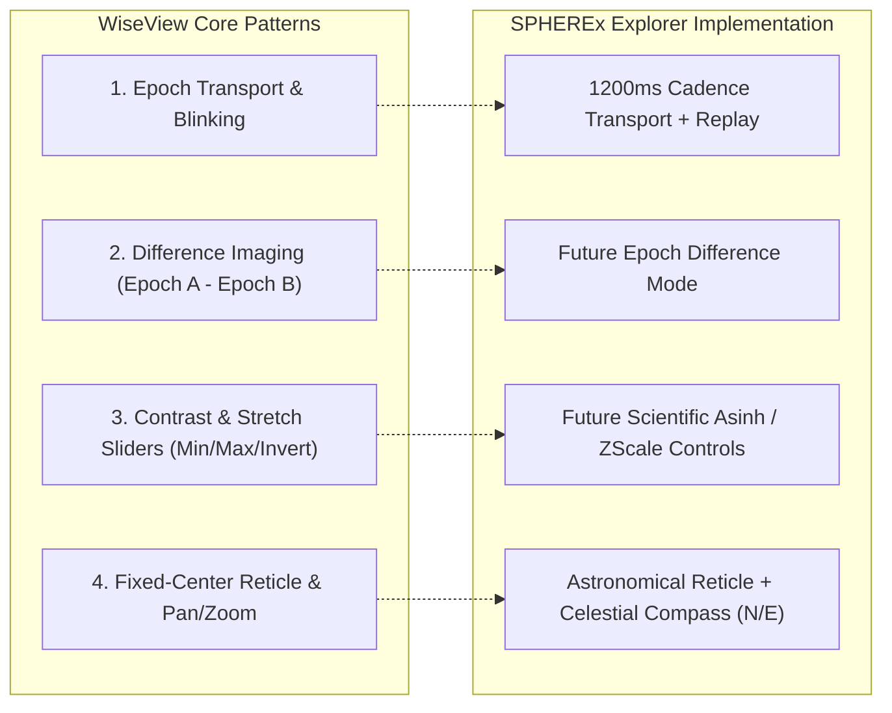

# WiseView Interaction Analysis & UX Inspiration for SPHEREx Explorer

**Project**: SPHEREx Explorer  
**Event**: 2026 NASA Space Apps Challenge  
**Document Version**: 1.0.0  
**Last Verified**: 2026-11-15  
**Audience**: Product Designers, UI/UX Engineers, Frontend Architects  

---

## 1. Executive Summary & Explicit Boundary Notice

**WiseView** ([http://byw.tools/wiseview](http://byw.tools/wiseview)) is a specialized, web-based astronomical visualization tool created by researcher Dan Caselden for the **Backyard Worlds: Planet 9** citizen science project. It allows professional astronomers and citizen scientists to visually inspect multi-epoch coadds from the Wide-field Infrared Survey Explorer (WISE/NEOWISE) to detect high proper motion stars, brown dwarfs, and solar system objects.

> [!CAUTION]
> ### EXPLICIT DATA & ARCHITECTURAL BOUNDARY:
> - **WiseView is NOT a SPHEREx data provider and does NOT host SPHEREx data.**
> - WiseView operates exclusively on unWISE coadds in optical/infrared W1 (3.4 µm) and W2 (4.6 µm) bands.
> - WiseView serves strictly as an **interaction design inspiration** for multi-epoch time-series navigation, blinking, and motion comparison. SPHEREx Explorer does not copy WiseView's proprietary codebase or create external dependencies on its servers.

---

## 2. Core Interaction Concepts in WiseView

WiseView's success in enabling the discovery of hundreds of sub-stellar objects and extreme proper motion stars stems from several proven interaction patterns:

### 2.1 Epoch Navigation and Blinking
- **Blink Comparator Paradigm**: Mimics the classic optical blink comparator used by Clyde Tombaugh to discover Pluto. Alternating rapidly between two or more discrete observation epochs makes stationary background stars appear static, while moving objects jump back and forth and variable stars flash.
- **Continuous Loop vs. Step Navigation**: WiseView provides both discrete frame-stepping (Next/Prev) and automated loop blinking with an adjustable playback cadence slider.
- **Key Frame Indicators**: Visual nodes indicating which epoch is currently active, with epoch timestamps clearly displayed.

### 2.2 Difference Imaging
- **Image Subtraction**: By subtracting an earlier baseline epoch from subsequent epochs ($\text{Epoch}_i - \text{Epoch}_1$), stationary background emission cancels out completely to near-zero background.
- **Motion Dipole Signature**: High proper motion objects leave a distinctive "dipole" signature (a dark negative hole paired with a bright positive peak), making motion instantly recognizable even in crowded fields.

### 2.3 Image Framing and Visual Controls
- **Target Centering**: The requested astronomical coordinate remains strictly locked at the center crosshairs while epochs change underneath.
- **Dynamic Contrast Stretching**: Real-time sliders for black-level (min) and white-level (max) thresholding, plus image inversion (dark stars on white background, which human vision perceives with greater sensitivity for faint point sources).
- **Smooth Zoom & Pan**: Non-destructive canvas zooming with pixelated or bilinear interpolation.

---

## 3. Valuable Interaction Patterns for SPHEREx Explorer

SPHEREx Explorer can adapt several of these proven paradigms to enhance user engagement during the 2026 NASA Space Apps Challenge:

| WiseView Interaction Pattern | SPHEREx Explorer Adaptation | Implementation Status |
| :--- | :--- | :--- |
| **Epoch Scrubber Bar** | 4-step interactive timeline scrubber with epoch nodes and dates | **Implemented (Phase 5)** |
| **Automated Playback** | 1200ms automated playback cadence with auto-stop on final frame | **Implemented (Phase 5)** |
| **Replay Action** | Dynamic `↺ Replay` button when sequence halts at final observation | **Implemented (TASK-502)** |
| **Center Crosshairs** | Optical bench reticle with central micro-ticks and coordinate readout | **Implemented (Phase 3/5)** |
| **Celestial Orientation** | Scientific North/East compass indicator (astronomical convention: East left) | **Implemented (Phase 3/5)** |
| **Variable Cadence** | Adjustable playback speed selector (e.g., 600ms, 1200ms, 2000ms) | *Planned (Phase F)* |
| **Epoch Difference Mode** | Toggle to view $(\text{Obs}_i - \text{Obs}_1)$ difference to highlight motion/variability | *Planned (Phase F)* |
| **Negative Color Invert** | Invert toggle to render dark absorption and emission profiles | *Planned (Phase F)* |

---

## 4. Key Differentiators: SPHEREx Explorer vs. WiseView

While WiseView focuses primarily on high-cadence blinking of two broad bands (W1/W2), SPHEREx Explorer is designed around the unique multi-dimensional capabilities of SPHEREx:

1. **Spectral Dimension (102 Wavelength Channels)**:
   - WiseView: 2 photometric bands (3.4 µm, 4.6 µm).
   - SPHEREx Explorer: 102 contiguous spectral channels from 0.75 µm to 5.00 µm, allowing users to inspect spectral variations alongside temporal changes.
2. **Physical Calibrations and Uncertainties**:
   - WiseView: Displays uncalibrated pixel values or arbitrary linear stretches.
   - SPHEREx Explorer: Exposes true physical surface brightness in $\text{MJy/sr}$, uncertainty variance from `VARIANCE`, and data quality flags from `FLAGS`.
3. **Observational Cadence**:
   - WiseView: Visualizes yearly coadds over 10+ years of WISE operations.
   - SPHEREx Explorer: Visualizes 6-month survey passes, capturing both stellar proper motion (e.g. Barnard's Star) and rapid photometric variability (e.g. RW Aurigae occultations and R Draconis pulsations).
4. **Targeted Educational Context**:
   - SPHEREx Explorer is purpose-built for the NASA Space Apps Challenge, incorporating verified target facts, coordinate transparency, and clear educational disclosures regarding mock vs. real data.
